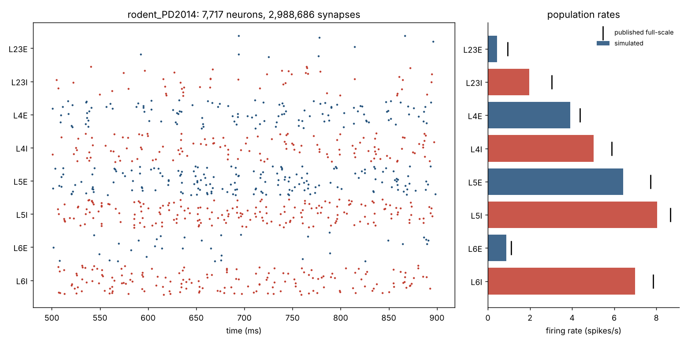
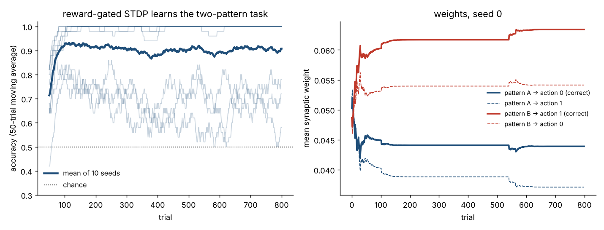
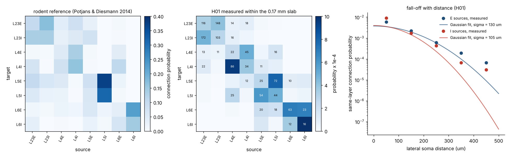
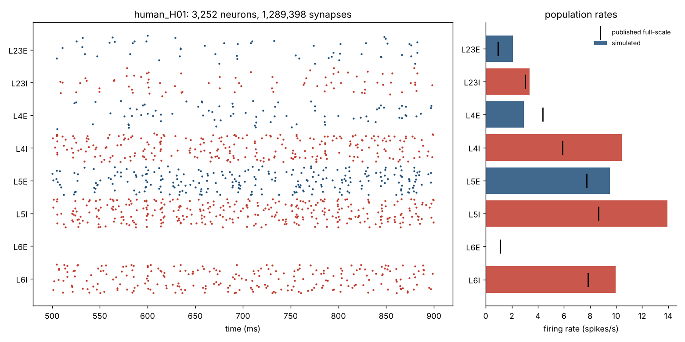
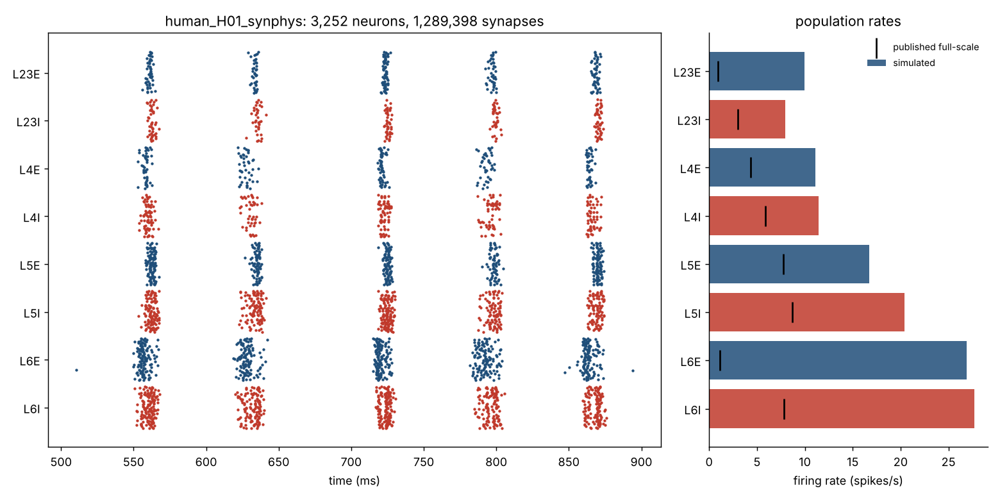
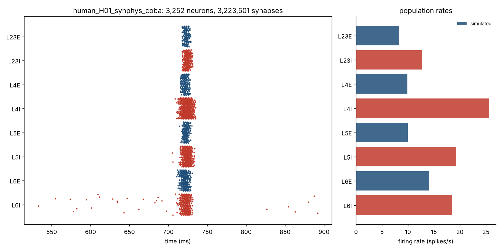

# synthetic-connectome

**Goal:** build a statistically faithful model of a human brain from the
data we actually have (one cubic millimetre of cortex at synapse resolution,
whole-brain histology atlases, MRI tractography), then let it learn with
biologically local, reward-gated plasticity.

**What the object is today (7 Nov 2026):** a model of human *association
cortex* — twelve cell populations per column with measured local wiring
(H01), membranes and synapses (Allen human data), at 1.5–3 % of the real
neuron count with full per-neuron in-degree; up to eight areas joined by
*macaque* long-range wiring; action selection by a basal-ganglia–thalamus
loop built from published rat circuit data (or the earlier hand-made
circuit); outcomes turned into a learning signal by a modelled dopamine
population with a critic that learns to predict them (or, as before, a
number applied from outside). It learns cue–action
tasks (96–97 % on the recalibrated column, Stage 25), routes real text at
58–63 % through a self-organising sensory layer (now also live, in shadow mode, beside RASPUTIN), reads printed letters at 87 % in font designs it has never seen (a V1-like edge front end feeding the learned letter layer; Stage 38), learns capitals from alphabet-book pairs without labels (Stage 41), and recognises 5,000 common words as units at 97 % in never-seen fonts (Stage 42). Against human recordings it has firing rates in
range for 9 of 12 populations and a field spectrum whose 30–45 Hz slope is
near awake human intracranial EEG but with far too little slow power (Stages
33–34). It is not a brain and not full-scale. Status by
roadmap stage: *Phase plan* below; full audit: `AUDIT.md`; working rules:
`METHODS.md`; **picking the project up: `HANDOFF.md`**.

This repository holds **Phase 0** (pipeline, validated on the rodent
reference column) and **Phase 1** (the same column re-fitted to the human
H01 data): the pipeline exists end to end at the scale of one cortical
column, both halves of the idea have been checked against something real,
and the first human-data-driven version runs.

| | What was done | Result |
|---|---|---|
| **Synthesis** | A cortical column generated *only* from layer statistics (cell counts, type-to-type connection probabilities, weight/delay distributions, a spatial profile). No wiring diagram is used anywhere. | 7,717 neurons, 2.99 M synapses in 5 s |
| **Validation** | Simulated with leaky integrate-and-fire neurons; per-layer firing rates compared to the published full-scale reference (Potjans & Diesmann 2014). | mean error 0.7 spikes/s across 8 populations; layer ordering of rates reproduced exactly |
| **Learning** | Three-factor "dopamine-gated" STDP (eligibility trace × global reward), plus homeostatic synaptic scaling. Network only ever sees right / wrong at the end of a trial. | 7 / 10 random initialisations reach 100 % on a two-pattern task; 3 stall at 65–75 % (see *Open problems*) |

| **Phase 2: measured synapses and membranes** | Human membrane parameters (Allen Cell Types, 413 neurons) and human synaptic strengths, spread and short-term plasticity (Allen Synaptic Physiology r2.1, 17,490 human pairs) extracted and folded into the column. Every parameter class now has a measured source. | membranes alone: all 8 populations active, L6E 1.2 spikes/s. Membranes + measured synapses: the column switches to **periodic network bursts** at ~13 Hz (see *Phase 2*) |
| **Phase 1: H01 fit** | Counts, densities, layer thicknesses, E/I split, lateral fall-off and the type-to-type connectivity of 29 well-sampled pathways measured from the full H01 synapse table (166 M synapses, via BigQuery) and a 3,111-neuron labelled sample. | human column: 32,515 neurons / mm², 7 of 8 populations fire at physiological rates; L6E unstable (see *Open problems*) |






## Quick start

```bash
pip install numpy scipy matplotlib brian2      # brian2 compiles with gcc if available
python scripts/run_column.py --preset rodent    # synthesize + simulate + validate (~1 min)
python scripts/run_column.py --preset human_h01 # human column fitted to H01 (Phase 1)
python scripts/run_learning.py --seeds 10       # reward-gated STDP testbed (~1 min)
python -m synth.h01_fit                         # print every H01-derived number and the blend
python scripts/plot_h01_fit.py                  # figure: H01 matrix vs rodent, lateral profile
python scripts/calibrate_human.py               # re-tune inhibitory multipliers toward target rates
python scripts/l6_stp_experiment.py             # static vs depressing synapses on the L6E runaway
# Phase 2, once the Allen files are available:
python scripts/extract_synphys.py  synphys_r2.0_small.sqlite      # -> results/synphys_human_summary.json
python scripts/extract_celltypes.py cell_types_specimen_details.csv # -> results/celltypes_human_summary.json
python scripts/run_column.py --preset human_h01_synphys           # column with measured strengths/dynamics
```

Reduce `--n-scale`/`--k-scale` for a smaller network, raise them toward 1.0
for the full 77k-neuron / 300M-synapse column (needs ~30 GB RAM in Brian2).

## Layout

```
synth/params.py     layer statistics; presets "rodent" (validated) and "human" (placeholder)
synth/h01_fit.py    every number measured from H01 + the blend that builds preset "human_h01"
synth/synphys_fit.py  folds Allen synaptic-physiology + cell-types summaries into preset "human_h01_synphys"
scripts/extract_*.py  stdlib-only extractors for the Allen sqlite / CSV; tests/make_mock_synphys.py builds a schema-faithful mock
synth/build.py      statistics -> explicit neurons (3D positions) + synapses (pre, post, w, delay)
synth/simulate.py   Brian2 LIF simulation with per-synapse delays and Poisson background
synth/analyze.py    rates, irregularity, synchrony, raster + rate figure
learning/rstdp.py   reward-modulated STDP with eligibility traces and synaptic scaling
scripts/            command-line entry points; results/ holds figures and logs
```

## How the synthesis works

1. **Counts.** Each of the 8 populations (L2/3, L4, L5, L6 × excitatory / inhibitory; 12 in the subtype preset, with inhibitory split into fast-spiking / other)
   gets its full-scale neuron number times `N_scaling`.
2. **Placement.** Neurons are scattered uniformly inside their layer's depth
   band within a 1 mm × 1 mm footprint. Layer thicknesses are a preset.
3. **Synapse numbers.** For every (target type, source type) pair, the
   connection probability is inverted to a synapse count (multapses allowed),
   giving an in-degree per target neuron, scaled by `K_scaling`.
4. **Partner choice.** Targets are drawn uniformly; for each target, sources
   are drawn with probability falling off as a Gaussian of lateral distance
   (σ = 300 µm). The normalisation keeps every population's in-degree exactly
   at the statistical value, so space changes *which* neurons connect, not
   *how many*. This is the Peters'-rule-style step that H01 morphologies
   would eventually replace.
5. **Weights and delays.** Normal around the type-pair mean (10 % and 50 %
   relative SD), PSP amplitudes converted to currents analytically; the
   L4E→L2/3E pathway is doubled as in the reference model.
6. **Scaling compensation.** When in-degrees are reduced, weights are raised
   by 1/√K and a DC current restores the mean input, using the known
   full-scale rates. This is why the 10 % network still reproduces the full
   network's rates.

## Phase plan

Original roadmap (seven stages to a full brain, plus the Warmind integration)
and where each stands. Full audit in `AUDIT.md`.

| Stage | Scope | Status (Nov 2026) |
|---|---|---|
| **1** | One column in the right state: asynchronous 1–10 Hz, no tuning knobs beyond external drive | **done with caveats** — 12 populations, dendrites, measured membranes/synapses/wiring, asynchronous; 9 of 12 populations within reference rate ranges after the Stage 25 recalibration (was 7); still 2 fitted calibrations + 5 assumed constants |
| **2** | Full-scale column (32,500 neurons, 130 M synapses) | **not done** — everything runs at 1.5–3 % of neurons with full in-degree; needs a GPU simulator and ≥64 GB |
| **3** | Cortical sheet: per-area layers (BigBrain), cell types (Allen), area wiring (HCP) | **started with substitutes** — multi-column sheet + 8 macaque association areas (Markov FLN); same column everywhere; no human atlas data yet (Stages 4–5) |
| **4** | Subcortex: thalamus, basal ganglia, hippocampus, neuromodulators, cerebellum | **started** — a spiking basal-ganglia–thalamus loop built from published rat circuit data (Humphries et al. 2006) replaces the hand-made selection circuit without loss (Stage 26); a dopamine population with a striosomal critic turns the outcome into a prediction error that every plastic synapse reads, the loop's cortico-striatal synapses learn (Stage 27) and, with the thalamic relay carrying a share of the pools' drive at its measured resting rate, carry the task on their own at 83 % (Stage 28); it reverses rules and runs in eight areas (Stage 29); with intrinsic homeostasis on the relay and 25 % of the pools' drive routed through it, it is within spread of the hand-made circuit in two areas (95 vs 96.5 % held-out) and ~5 points below in eight (Stages 30–31); with homeostasis on the critic and value cells the dopamine burst moves to the cue with learning intact (Stage 30); it routes real queries better than the hand-made circuit (58 vs 52 %, Stage 32); relay membranes and the routed share are still assumed, no reticular nucleus; surprise/uncertainty still scalar formulas; no hippocampus or cerebellum |
| **5** | Senses and a body | **partial, by another route** — RASPUTIN as a toy body; self-organising sensory layers for text and printed letters (Stages 20–23); no retina/cochlea/motor, no speech yet |
| **6** | Learning across the sheet with dopamine from the basal ganglia | **most progress** — three-factor rule, gating, turnover, surprise, uncertainty; 95–97 % on cue tasks (v2 column), 58–63 % routing real text; the learning signal can come from the modelled dopamine population rather than a number from outside (Stages 27–30); but plasticity on one inter-areal pathway plus cortico-striatal synapses only, and 9 evolved rule settings (Stages 6–32) |
| **7** | Validation against human recordings (intracranial, EEG/MEG, fMRI, behaviour) | **started** — firing rates vs reference ranges; field spectrum vs awake human iEEG (Stages 33–34): with a corrected LFP proxy the 30–45 Hz slope is near the human value (−2.2 vs −2.8/−3.0) and a beta rhythm sits near the frontal band; slow (<4 Hz) power is ~25 dB too low (open problem 13) |
| **8** | Warmind / RASPUTIN integration | **done for v1, routing in shadow** — live core, tool actions, trained through the tool; a shadow router (sensory text layer + basal-ganglia loop + dopamine) learns RASPUTIN's routing decisions live without changing them (Stage 32); 17 tests |

Earlier sub-phases: Phase 0 (rodent pipeline) done; Phase 1 (H01 fit) done;
Phase 1b (Allen physiology) done.

## Phase 1: what H01 says about a human column

Method (reproducible from `synth/h01_fit.py` and the SQL in the session log):

1. Cell types and layers for 45,994 soma-bearing cells came from the H01
   authors' analysis tables on GitHub. The 166,216,068-synapse c3 export
   (`gs://h01-release/data/20210729/c3/synapses/exported/`, newline JSON)
   was loaded into a BigQuery table with one `LOAD DATA` statement.
2. A stratified sample of 3,111 labelled neurons (300 per layer × E/I, all
   111 L6 interneurons) was joined against every synapse. Synapses were kept
   only when their ultrastructural E/I class matched the presynaptic cell's
   type; this removes the merge-error contamination that otherwise makes
   pyramidal segments look as if they emit mostly inhibitory synapses.
3. Connection probability = connected pairs / possible pairs per
   (target, source) population; lateral fall-off from all same-layer pairs
   using soma centroids.

**Measured:**

| quantity | H01 | rodent reference |
|---|---|---|
| neurons per 1 mm² column (L2–L6) | 32,515 | 77,169 |
| cortical thickness L1–L6 | ≈ 2.2 mm | ≈ 1.5 mm |
| interneuron fraction L2/3 · L4 · L5 · L6 | 35 % · 21 % · 24 % · 12 % | 22 % · 20 % · 18 % · 17 % |
| lateral σ of connection probability (E / I sources) | 130 / 105 µm (lower bounds, slab-truncated) | not in reference model |
| type-pair matrix | 29 of 64 entries with ≥ 10 connected pairs | all 64 |

The measured matrix has the same shape as the rodent one where both are
sampled: same-layer E→I and I→E are the strongest local pathways, L5I→L5E
is the strongest single entry in both (0.375 fitted vs 0.373 rodent, an
independent check), and L4E→L4I / L6E→L6E stand out in both.

**Blend used in `human_h01`:** H01 relative in-degrees for the 29 trusted
entries, scaled by one factor (588×, the median slab→column ratio) to the
rodent in-degree magnitude; rodent in-degrees for the 35 entries H01 cannot
see (chiefly long translaminar pathways such as L2/3→L5 and L6→L4, because
the slab is only 0.17 mm thick). External drive and neuron parameters stay
rodent. Synaptic strengths are unknown in H01, so inhibitory weights onto
each population are multiplied by a factor that restores the rodent E/I
input balance, then refined by `scripts/calibrate_human.py`.

**Result:** the column runs at 2–14 spikes/s in 7 of 8 populations, with
asynchronous irregular activity. L6E stays silent, and any attempt to wake
it tips the whole column into a 200–300 spikes/s runaway: see open problem 5.

## Phase 2 (prepared): strengths and dynamics from patch-clamp data

H01 gives counts, not strengths. Two Allen Institute datasets supply the
rest, from the same cortical region (human middle temporal gyrus):

* **Synaptic Physiology** (Campagnola et al., *Science* 2022; file used:
  `synphys_r2.1_small.sqlite`, on the project's GitHub release
  `andrewreynolds421-ui/Human-Brain`, tag `Data`): multipatch
  recordings; per connected pair the PSP amplitude, latency, kinetics,
  short-term plasticity measurements and a fitted release model. Also an
  untruncated connection-probability-vs-distance curve and intrinsic
  membrane properties for the same cells. Distributed as sqlite files via
  `pip install aisynphys` or the `allen-synphys` AWS bucket.
* **Cell Types** (celltypes.brain-map.org): single-cell electrophysiology
  features for human neurons by layer and dendrite type.

`scripts/extract_synphys.py` and `scripts/extract_celltypes.py` need only
the standard library and write one JSON summary each. `synth/synphys_fit.py`
builds the `human_h01_synphys` preset from them: a measured 8×8 PSP matrix,
measured weight spread, Tsodyks-Markram parameters per class pair
(U = base release probability, τ_rec = depression τ, τ_fac = facilitation
τ), and per-population membrane time constant, capacitance, threshold and
rest. Every entry records whether it came from a layer-specific group, a
pooled class group, or stayed rodent (`params.provenance`).

**Cell Types result (data in hand).** From `cell_types_specimen_details.csv`,
413 human neurons (temporal and frontal cortex): pyramidal cells have
membrane time constants of 23–30 ms (the rodent model uses 10 ms), input
resistances of 78–235 MΩ and capacitances of 120–300 pF; interneurons
12–22 ms and 45–100 pF; resting potentials −68 to −75 mV; spike threshold
estimated from rheobase sits 10–16 mV above rest (the model used 15). With
these per-population values and a re-calibration of the inhibitory
multipliers, the column (`human_h01_synphys`, membranes only so far) runs
with **every population active**: 0.4 / 2.6 / 12.8 / 12.9 / 11.6 / 11.3 /
1.2 / 9.4 spikes/s for L2/3E … L6I, irregular firing (CV of ISI 0.7–1.1).
The slower, larger human neurons soften the L6E bistability enough that a
static-synapse column can hold L6E at a low rate; L4E/L4I remain about 2×
too fast, and L4E shows some synchrony.



**Synaptic Physiology result (data in hand).** `synphys_r2.1_small.sqlite`
(169 MB, fetched from the project's GitHub release) holds 3,306 human cells
and 17,490 human cell pairs. Pooled by class, with type-consistent synapses
and the authors' "probed" criterion:

| pair | probed | connected | p | unitary PSP | PPR 50 Hz | release prob. U | depression τ | facilitation τ |
|---|---|---|---|---|---|---|---|---|
| E→E | 2,190 | 214 | 0.098 | **0.38 mV** | 0.76 | 0.52 | 193 ms | 620 ms |
| E→I | 284 | 62 | 0.218 | 0.87 mV | 0.69 | 0.42 | 307 ms | 173 ms |
| I→E | 246 | 39 | 0.159 | **−0.32 mV** | 0.60 | 0.38 | 299 ms | 555 ms |
| I→I | 122 | 10 | 0.082 | −0.59 mV | 0.45 | 0.40 | 208 ms | 407 ms |

Layer-resolved where sampled: L3E→L3E p = 0.149 (676 probed), L2E→L2E
0.129, L3E→L3I 0.32, L3I→L3E 0.31, L5E→L5E 0.076. Connection probability
falls from 0.125 (< 50 µm) to 0.037 (200–250 µm), a Gaussian σ ≈ 140 µm,
independently confirming the 130 µm from H01. Amplitude distributions are
broad and skewed (IQR/median ≈ 1.1–1.4), so the model now draws weights
lognormally. Membrane constants from these cells agree with the Cell Types
export (L3 pyramidal τ 20.6 vs 23.5 ms).

**What happens when all of it goes in.** Two numbers dominate. Human E→E
synapses are 2.5× stronger than the rodent model's 0.15 mV, and somatic
I→E IPSPs are half as strong as the model's −0.6 mV; the measured
|IPSP/EPSP| ratio is 0.85 where a current-based point-neuron network needs
≈ 4 for balance. Plugged in as measured, every population saturates
(100–440 spikes/s). With inhibitory columns scaled up to recover the
rodent balance and then calibrated, the column is active in all layers at
8–28 spikes/s, but in a qualitatively new state: **periodic network bursts
at ~13 Hz**, each ~15 ms long, starting in L6 and sweeping all layers,
silence in between (Fano factors 20–250 instead of ~1).


That is a result, not a tuning failure. It says that slice-measured somatic
amplitudes, in a current-based point neuron, cannot reproduce the
asynchronous state real cortex sits in. The physics the model lacks is
known: inhibitory *conductances* whose effect grows as the neuron
depolarises (an IPSP measured at rest understates inhibition near
threshold), the dendritic placement of excitation versus perisomatic
inhibition, and in vivo background synaptic noise. Open problem 8.

**Mechanism test with placeholder dynamics.** With *textbook* depressing synapses
(U = 0.5, τ_rec = 800 ms for E→E and similar for the other classes), the
L6E instability changes character. Lowering inhibition onto L6E:

| inhibition onto L6E | static synapses: L6E / rest of column | depressing synapses: L6E / rest of column |
|---|---|---|
| ×2.47 (calibrated) | 0 Hz / normal | 0 Hz / normal |
| ×1.5 | **250 Hz**, column at 80–150 Hz | 55 Hz, column at 16–60 Hz |
| ×1.0 | **375 Hz**, column at 110–220 Hz | 112 Hz, column at 16–61 Hz |
| ×0.6 | **420 Hz**, column at 120–240 Hz | 149 Hz, column at 16–61 Hz |

Depression removes the all-or-nothing runaway: L6E can be active without
dragging every other layer to saturation. Its rate is still too high, which
is the quantitative question the human U and τ_rec values will answer.

## Stage 1 attempt: conductance synapses, no tuning knobs

Goal: the fully measured column fires asynchronously at 1–10 spikes/s with
no per-population tuning. Changes made, all of them physics or data rather
than knobs:

* **Conductance-based synapses** (`synapse_model="coba"`, `synth/network.py`):
  reversal potentials 0 / −75 mV, decay 2 / 6 ms. Each measured PSP is
  converted to a conductance at the holding potential it was measured at
  (−70 mV for EPSPs, −55 mV for IPSPs in the Allen protocol), so in the
  running network inhibition grows and excitation shrinks as cells
  depolarise. Near threshold this gives ~2.3× more inhibition relative to
  excitation than the current-based model had.
* **Per-contact amplitudes**: a unitary PSP is the sum over all contacts of
  one connection; H01 gives 1.5–1.8 synapses per connection, so each
  synapse carries unitary / that.
* **Spike-frequency adaptation** (adaptive LIF, generic constants: 60 pA
  per spike on excitatory cells, 10 pA on interneurons, τ = 150 ms); the
  Cell Types export has the adaptation index to fit these properly later.
* No per-population inhibitory multipliers, no rate-based DC compensation.
  The one remaining knob is the gain on the external drive.

Result (`scripts/stage1_scan.py`, 10 % of the column, in-degree at 25 %):

| external gain | mean rate | regime |
|---|---|---|
| 0.15 | 0 | silent |
| 0.30 | 8–25 spikes/s | **bursting**: one 20 ms all-layer burst every 300–400 ms |
| 0.50 | 15–53 | bursting |
| 0.80 | 24–102 | bursting |
| without adaptation, ≥ 0.5 | 100–450 | saturated |



Robust to the obvious alternatives: GABA reversal −65 instead of −75 mV,
3 ms instead of 6 ms inhibitory decay, and in-degree 100 % instead of 25 %
all burst the same way; removing short-term plasticity makes it worse
(three populations saturate, the rest fall silent).

**Verdict: stage 1 not reached.** The measured column no longer saturates
(adaptation fixed that) and no longer needs any per-population tuning, but
it lives in a slow-oscillation state like a cortical slice or anaesthetised
cortex, not the asynchronous awake state. Adaptation plus synaptic
depression set the ~3 Hz period. What it points at next, in order of how
cheap it is to test:

1. **Interneuron subtypes.** The I→E amplitude used here is the median over
   all human interneurons (−0.32 mV). Fast-spiking basket cells, which do
   most of the work of desynchronising cortex, have much larger, faster
   perisomatic IPSPs. The Synaptic Physiology database separates subclasses
   for mouse and has morphology for human; splitting L23I/L4I/L5I/L6I into
   fast-spiking and other interneurons is the next data-driven change.
2. **Fitting adaptation** to the Cell Types adaptation index and f–I slope
   instead of generic constants.
3. **Dendrites.** Excitation lands on dendrites, inhibition near the soma;
   a two-compartment neuron is the smallest model that can express that.

The live core keeps running the earlier calibrated states until one of
these produces an asynchronous column; the `human_h01_coba` preset is
available for experiments (`--preset human_h01_coba`).

## Stage 2: fast-spiking and other interneurons (12 populations)

**Step 1 — the split** (`scripts/extract_synphys_subtypes.py` →
`results/synphys_human_subtypes.json`). Human interneurons in the Synaptic
Physiology database are labelled fast-spiking (FS) when their action
potential is narrower than 0.7 ms (gap in the width distribution). Of 100
with intrinsic recordings, 38 are FS (95% CI 29–48%); 39 more have no
recording. The FS group is independently consistent with fast-spiking cells:
upstroke/downstroke 2.0 vs 2.8, 30 vs 19 spikes/s at 40 pA, membrane tau
12 vs 20 ms, near-zero adaptation.

| pair | probed | connected | p | PSP (mV) | notes |
|---|---|---|---|---|---|
| E→FS | 79 | 20 | 0.25 | +1.18 (n=16) | PPR 0.52, U 0.34 |
| E→other | 84 | 8 | 0.095 | +0.35 (n=5) | |
| FS→E | 70 | 13 | 0.19 | −0.17 (n=8) | recovers in ~50 ms |
| other→E | 75 | 2 | 0.027 | not measured | |
| I→I (any) | 77 | 2 | — | — | too few to split |

80% of the classified cells are in L2/3; per-layer fractions elsewhere rest
on 4–9 cells and are not used. Cell Types aspiny cells are split the same
way by upstroke/downstroke ratio < 2.0 (51 of 79), used for membranes only.

**Step 2 — the 12-population column** (`synth/subtypes_fit.py`, preset
`human_h01_12pop`). Every rule is a measured ratio on top of the
8-population column; nothing is tuned. Total inhibitory synapses onto each
cell type stay at the H01 value; the measured connection probabilities only
decide *who* supplies them (FS supply 81% of inhibition onto E cells) and
*who* receives excitation (FS cells get 1.6×, others 0.6× the average).
Amplitudes, release-model dynamics and membranes come from the subtype data
where n ≥ 3, otherwise the class value (provenance printed on load). The
population layout is now a property of the column (`ColumnParams.populations`),
so the 8-population presets are unchanged (verified bit-for-bit).

**Result** (`scripts/stage1_scan.py --preset human_h01_12pop`, same settings
as stage 1, external-drive gain 0.15–1.0):

| | 8 populations | 12 populations |
|---|---|---|
| synchrony (Fano, 1 = asynchronous) | 220–365 | 18–48 |
| regime | bursting at every gain | bursting, much weaker |
| bursts start in | all layers at once | L6E, spreading to L4/L5 FS |
| with L6E→L6E cut (diagnostic only) | — | 2.9–3.4 (≈ asynchronous) |

So the split removes most of the synchrony, and what remains is the L6
recurrent loop (open problem 5), now unmasked. Two new issues: L2/3 and L5
excitatory cells are almost silent (< 0.5 spikes/s) while L4 FS cells fire
50–150 spikes/s. The FS cells receive the full (rodent-valued, unmeasured)
external drive plus 1.6× the recurrent excitation; the external input is
now the largest unmeasured assumption in the model.

Next, in order: (a) L6 — inhibition onto L6E is ~1/3 of the rodent value
because the L6 interneuron population is small; check whether L5 FS axons
supply L6 (H01 translaminar entries) and whether multi-synapse I→E contacts
close the gap. (b) External drive per cell type instead of the rodent
counts (thalamic input lands mainly on L4 E and FS; cortico-cortical on
L2/3 and L5). (c) Adaptation fit (step 4), then dendrites.

### Stage 2b: H01 postsynaptic input budget

H01 labels every synapse excitatory or inhibitory, so the share of inhibitory
input onto each cell type can be read off without knowing where each input
came from (BigQuery: all synapses onto the 3,111 labelled neurons, cells with
≥ 50 inputs, 4.25 GB scanned):

```sql
WITH per AS (
  SELECT s.post_synaptic_partner.neuron_id AS nid,
         COUNTIF(s.type = 1) AS n_inh, COUNTIF(s.type = 2) AS n_exc
  FROM h01.synapses_c3 s
  WHERE s.post_synaptic_partner.neuron_id IN (SELECT neuron_id FROM h01.neurons)
  GROUP BY nid)
SELECT n.cell_type, n.layer, COUNT(*), SUM(n_inh), SUM(n_exc)
FROM per JOIN h01.neurons n ON n.neuron_id = per.nid
WHERE n_inh + n_exc >= 50 GROUP BY 1, 2
```

| inhibitory share of inputs | L2/3 | L4 | L5 | L6 |
|---|---|---|---|---|
| H01, onto E | 0.35 | 0.36 | 0.36 | **0.33** |
| model before, onto E | 0.35 | 0.29 | 0.21 | **0.15** |
| H01, onto I | 0.46 | 0.40 | 0.40 | 0.46 |
| model before, onto F / N | 0.17 / 0.35 | **0.04** / 0.10 | 0.08 / 0.18 | 0.14 / 0.29 |

The pair-based wiring (presynaptic soma required inside the 0.17 mm slab)
undercounts small interneuron populations; L6E got under half its measured
inhibition. H01 interneurons also receive 0.34–0.83× as many synapses as
pyramidal cells of their layer, while the model gave L4 FS cells 3.6×.
`apply_input_budget` (`synth/subtypes_fit.py`, on by default) rescales each
population's in-degree to the measured total and inhibitory share, keeping
the relative contribution of each source population.

Result (same scan): every excitatory layer is now active (L2/3E 6–16
spikes/s, was ~0), FS rates fall from 50–150 to 14–100 spikes/s, but the
column still fires in column-wide volleys every ~80 ms (Fano 27–56).
Diagnostics at gain 0.5:

| change (diagnostic only) | synchrony | note |
|---|---|---|
| none | 33 | |
| full in-degree (K = 1) | 57 | not a scaling artifact |
| L6E→L6E cut | 17 | L6 no longer the sole trigger |
| adaptation b = 0 / 20 pA | 29 / 37 | adaptation is not the cause |
| no E→E depression | 0.9 | all E saturate at ~460 spikes/s |
| no short-term plasticity | 73 | |

Short-term depression at E→E synapses is what terminates each surge: the
column sits in the "population spike" regime, where recurrent excitation is
strong enough that only synaptic fatigue stops it. Candidates, in order: the
balance of external (asynchronous, long-range) versus local recurrent
excitation, which is still the rodent value and the largest unmeasured
number; per-contact E→E amplitude (unitary / 1.5 contacts); and
dendritic location of excitation (two-compartment neuron).

### Stage 2c: where the rhythm comes from

Question: is the column pulsing because its input arrives at regular
intervals? `scripts/rhythm_diagnostics.py`, gain 0.5, 2.5 s runs.

| test | pulses | beat (autocorrelation peak) | interval CV |
|---|---|---|---|
| baseline (Poisson input), seeds 1 / 2 | yes | 54 / 52 ms | 0.53 / 0.66 |
| input only, no within-column synapses | no (Fano 2.2) | — | — |
| perfectly steady input, same mean | yes (Fano 183) | 52 ms | 0.49 |
| input fibres 4x faster / 4x slower | yes | 50 / 52 ms | 0.61 / 0.53 |

The input is not the cause: the rhythm survives with no input fluctuations
at all and ignores the input's timing. Intervals cluster at ~50 ms and its
multiples (a ~20 Hz cycle that sometimes skips). Which internal time
constant sets it (steady input):

| change | beat | synchrony (Fano) |
|---|---|---|
| none | 52 ms | ~180 |
| FS→E recovery 25 / 100 / 200 ms (measured 49) | 54 / 62 / 68 ms | 176 / 333 / 493 |
| adaptation tau 300 ms (150) | no clear beat | 176 |
| GABA conductance decay 3 / 12 ms (6, generic) | 42 / 88 ms | 98 / 430 |
| E membrane tau ×0.5 / ×2 | weak / 50 ms | 44 / 213 |

The beat follows the inhibitory decay time and the pyramidal membrane:
it is an excitation→fast-spiking→inhibition feedback cycle (the mechanism
behind cortical beta/gamma rhythms), far too strong here, with E→E
depression deciding which cycles ignite. Two of its settings are not
measured: the GABA decay (generic 6 ms) and the slow resting membranes of
pyramidal cells, which in vivo are 2–5x faster because of constant synaptic
bombardment (the high-conductance state) that a 10% column with Poisson
input does not supply. Next: measured IPSC decay from the human Synaptic
Physiology recordings, and an effective-membrane test with background
conductance matching in vivo levels.

### Stage 2d: measured synaptic kinetics and an in-vivo background

All runs: 12 populations, H01 input budget, steady 2.5 s, whole-network
Fano factor of the population rate (2 ms bins; 1 = asynchronous).  This is a
stricter measure than the per-population value in the tables above; the
stage 2c baseline scores ~160 on it.

**1. Measured synaptic current decay** (`measured_kinetics=True`, default).
Voltage-clamp PSC decay from the human Synaptic Physiology recordings, per
target cell type (n ≥ 3): E→E 7.2 ms (n=108), E→FS 1.9 ms (n=17), E→other
3.8 ms (n=6), I→E 11.1 ms (n=15); I→I has n=1 and keeps the generic 6 ms.
(Somatic recordings slow dendritic currents, so E→E is likely an
overestimate; perisomatic FS→E much less so.)  Synchrony 160 → 32 at
gain 0.5 and 141 → 40 at gain 0.8: fast excitation of FS cells against slow
excitation of pyramids lets inhibition catch each surge earlier.

**2. Balanced background conductance** (`bg_ratio`, off by default).
Poisson excitation + inhibition with mean conductance = bg_ratio × leak,
zero net current at −60 mV; in vivo values are ~1–5× (Destexhe, Rudolph &
Paré 2003, review).  Not from the H01 / Allen data.

| background | gain 0.5 | gain 1.0 | gain 2.0 |
|---|---|---|---|
| none | 32 | — | — |
| 1× leak | 13 (L2/3E 0.1 Hz) | | |
| 2× leak | 7 (L2/3E silent) | | 25 (beat 42 ms) |
| 4× leak | 2 (most E silent) | 10 | 26 (beat 36 ms) |

It removes the rhythm only by quieting the column; once drive is raised to
re-activate pyramidal cells, a faster (26–42 ms, gamma-band) E–FS cycle
returns at Fano ~25–30.

**3. Two things tried and rejected or fixed.**
* *External input budgeted per cell type* (same outside share of excitation
  for every cell in a layer; `ext_budget`, off): worse — non-FS cells and
  L5E fell silent, Fano 39–45.
* *L5 pyramidal silence* came from a layer-specific L5I→L5E amplitude
  (−0.72 mV) resting on 4 recordings, 3× the pooled value.  The 12-population
  preset now requires n ≥ 10 for layer-specific amplitudes
  (`min_n_layer_pair=10`; only L2/3 entries qualify), otherwise pooled across
  layers.  L5E fires again (0.7 Hz, still the lowest population).

**Where it stands.** With every change data-backed, the active column has a
synchrony floor of ~25–40 (from ~350 at the start of stage 1) and an E–FS
cycle whose period follows inhibitory kinetics. FS cells fire 3–5× faster
than pyramidal cells. The remaining structural gap is that excitation in the
model lands at the soma; in cortex it lands on dendrites, electrically
distant from the perisomatic FS inhibition. A two-compartment neuron is the
next test.

### Stage 3: inputs placed on soma or dendrite (two-compartment pyramidal cells)

`synth/dendrite.py`, preset `human_h01_dendritic`. Pyramidal cells get a
passive dendrite coupled to the integrate-and-fire soma; interneurons stay
compact. Placement: excitation (local and external) and non-fast-spiking
inhibition on the dendrite, fast-spiking (basket) inhibition on the soma,
everything onto interneurons on the soma.

* **Measured amplitudes preserved.** Each synapse's conductance is computed
  so that, delivered to its compartment, it gives the measured *somatic* PSP.
* **Coupling from data.** Somatic voltage clamp slows E→E currents to
  7.2 ms (n=108) against 2.2 ms onto compact interneurons (n=26). That
  slowing is the dendrite's filtering, so the coupling is set so the
  dendrite's clamped time constant, τm(1−A), equals 7.2 ms: attenuation
  A = 0.68 (L2/3), 0.75 (L4), 0.77 (L5), 0.71 (L6), and excitatory
  conductances use the unfiltered 2.2 ms. Check: the resulting somatic EPSP
  decays in ~25 ms against 22.8 ms measured. The dendritic share of
  membrane (0.7) is a generic reduced-model value.
* With very tight coupling the model reduces exactly to the one-compartment
  cell (verified).

Result (whole-network Fano, 2.5 s, 10% column, K 0.25):

| | gain | L2/3E L4E L6E (Hz) | synchrony |
|---|---|---|---|
| one compartment | 1.0 | 9.1 4.3 7.7 | 40 |
| two compartments | 1.0 | 5.2 2.9 4.8 | 15 |
| two compartments | 1.5 | 6.9 4.0 4.9 | 17 |
| two compartments + background 2× leak | 2.0 | 5.8 3.8 3.8 | **8** |
| two compartments + background 4× leak | 4.0 | 2.9 4.2 1.1 | 3 |

Placing inputs cuts synchrony ~2.5× at matched pyramidal activity; with
the in-vivo background the active column reaches ~8 (asynchronous ≈ 1–3;
this column scored ~160 on the same measure before stage 2d). Remaining:
interneurons fire 3–10× faster than pyramidal cells, and L5 pyramidal cells
stay near-silent (≤ 0.5 Hz). More drive raises interneuron rates rather than
pyramidal ones, so the next question is the excitation each interneuron
type receives.

**Warmind.** `NEURAL_CORE_MODE=dendritic` runs this column live (ext gain
2.0, background 2×), and RASPUTIN's `neural_core` tool has a `set_model`
action to switch between `membranes`, `full` and `dendritic` while running.
At 10% scale the dendritic mode runs at ~0.08× real time here (membranes:
~0.33×), so the default stays `membranes`.

### Stage 3b: finishing the column — full connectivity and the deep-layer problem

Probe (dendritic column, K 0.25, gain 2, background 2×; mean somatic values):

| pyramidal | rate (Hz) | below threshold | somatic inhibition |
|---|---|---|---|
| L2/3 | 5.7 | 7.0 mV | 46 nS |
| L4 | 3.9 | 8.1 mV | 35 nS |
| L5 | 0.2 | 12.2 mV | 74 nS |
| L6 | 3.7 | 10.5 mV | 75 nS |

Interneurons fire 17–75 Hz, mostly on external drive, which every cell
receives at the rodent fibre count. `ext_budget="h01"` scales external
fibres onto interneurons by the H01 ratio of excitatory synapses per
interneuron to per pyramidal cell in the layer (0.28 / 0.78 / 0.56 / 0.32);
at K 0.25 this lifts L2/3 pyramids (10.7 Hz) but not L5.

**Full connectivity (K = 1, 10.4 M synapses, no scaling compensation)** —
the 25% in-degree runs used so far boost each synapse by 2× and compensate
only the external mean, which adds synchrony:

| K = 1, ext_budget h01 | L2/3E | L4E | L5E | L6E | synchrony |
|---|---|---|---|---|---|
| gain 2, background 2× | 1.1 | 1.7 | 0.1 | 0.1 | 4 |
| gain 3, background 2× | 1.8 | 1.7 | 0.1 | 0.1 | 4 |
| gain 4.5, background 2× | 2.1 | 1.2 | 0.2 | 0.1 | 3 |
| gain 2, no background | 3.4 | 1.8 | 0.0 | 0.5 | 16 |
| gain 3, no background | 3.7 | 1.9 | 0.0 | 0.5 | 14 |
| gain 2, no bg, 50% / 80% of FS synapses on dendrite | 3.6 / 3.8 | 1.9 / 2.2 | 0.0 / 0.1 | 0.9 / 1.6 | 21 / 23 |

At full size the column is asynchronous with the in-vivo background
(synchrony 3–4): the remaining pulsing at K 0.25 was largely a scaling
artifact. But L5 and L6 pyramidal cells are silent under every data-backed
configuration, and extra external drive goes into interneurons. Moving
fast-spiking synapses to the dendrite (H01: only 2–7% of inhibitory
synapses onto pyramids are on the soma proper; `fs_soma_fraction`) barely
changes it. A likely cause is input the data under-represent: the 0.17 mm
slab truncates the large apical dendrites of deep pyramidal cells (H01 counts
1,882 inputs per L5 pyramid vs 3,214 for L2/3, although L5 cells are larger),
and in vivo deep layers receive thalamic and long-range input that neither
dataset measures.

### Stage 3c: deep-layer calibration and robustness (the column is finished)

**The one calibrated number.** L5 and L6 pyramidal cells receive extra
external fibres (`deep_ext_gain`, `results/deep_ext_calibration.json`,
`scripts/calibrate_deep.py`), standing in for thalamic / long-range input
and apical-tuft input that the H01 slab truncates. Targets were awake rates
(L5 ~4 Hz, L6 ~2 Hz); L5 saturates because local fast-spiking feedback grows
with it:

| L5E / L6E multiplier | 3 / 3 | **8 / 8** | 18 / 8 | 30 / 8 |
|---|---|---|---|---|
| L5E Hz | 1.2 | **2.2** | 2.3 | 2.7 |
| L6E Hz | 1.0 | **1.7** | 1.2 | 1.2 |

The smallest multiplier on the plateau (8×) is used. Everything else is
measured or a stated generic constant.

**Final configuration**: `human_h01_dendritic`, `ext_gain=2.0`,
`ext_budget="h01"`, background 2× leak, full connectivity (K = 1).

| run | neurons | synapses | L2/3E | L4E | L5E | L6E | FS (L2/3–L6) | synchrony |
|---|---|---|---|---|---|---|---|---|
| seed 1 | 3,253 | 10.4 M | 1.1 | 0.9 | 2.2 | 1.7 | 2–26 | 6 |
| seed 2 | 3,253 | 10.4 M | 1.0 | 0.9 | 2.2 | 1.7 | 2–25 | 5 |
| seed 3 | 3,253 | 10.4 M | 1.1 | 0.9 | 2.2 | 1.7 | 2–25 | 6 |
| 2× size | 6,502 | 20.7 M | 1.3 | 1.1 | 1.7 | 1.6 | 2–23 | 9 |

Firing is irregular (CV 0.57–0.59), rates are reproducible to 0.1 Hz across
seeds, and the population Fano factor at double size is what unchanged
pairwise correlations predict (it scales with neuron count). Pyramidal cells
fire 1–2 Hz, fast-spiking cells 2–26 Hz: the sparse, asynchronous regime of
awake cortex. Known residuals: L4 non-FS interneurons fire ~20 Hz (high) and
L2/3 non-FS ~0.1 Hz (low); E→nFS and nFS→E rest on 2–6 recordings.

Warmind `NEURAL_CORE_MODE=dendritic` now runs exactly this configuration
(full connectivity regardless of `NEURAL_CORE_SCALE`, which sets size only).

### Stage 3d: a flaw found by the multi-column test, and the fix

Driving layer 4 of one column with a thalamus-like volley gave no pyramidal
response. A voltage probe showed why: the dendrite sat at **−33 mV** at
rest (16 nS excitation, 3.5 nS inhibition), close to the excitatory
reversal, so extra input added almost no current — while the soma was held
by 28 nS of inhibition. Two placement choices caused it, both contradicted
by data: all fast-spiking inhibition on the soma (H01: only 2–7% of
inhibitory synapses onto pyramids are on the soma proper), and the in-vivo
background entirely on the soma (70% of the membrane is dendrite).

Fix: background spread over compartments by membrane share
(`bg_by_membrane`, default on), and 70% of fast-spiking synapses onto
pyramids placed on the dendrite (`fs_soma_fraction=0.3`, the soma
compartment standing for soma + proximal dendrite). Dendrite at rest
−55 mV; a pyramidal-only volley now raises L4E 0.14 → 1.06 Hz (≈7×,
previously ≈2×). The deep-layer calibration was refitted and shrank:

| L5E / L6E multiplier | 1 / 1 | 3 / 3 | 4 / 2 | **5 / 2.5** |
|---|---|---|---|---|
| L5E / L6E Hz | 0.2 / 0.6 | 2.4 / 3.8 | 3.3 / 1.6 | **4.0 / 2.1** |

L5 now reaches its 4 Hz target (the stage-3c saturation at 2.5 Hz was the
saturated dendrite). Final single column (K = 1, 10% scale): L2/3E 1.7,
L4E 0.8, L5E 4.0, L6E 2.1 Hz, CV 0.58, Fano 12. These are now the defaults
of `human_h01_dendritic`; the stage-3c fit is kept in the calibration file
as superseded.

## Stage 4: multiple columns (started)

`synth/sheet.py`. `make_sheet(params, n)` builds an n × n mm sheet (n²
columns) with every neuron's local in-degree unchanged; local partners
follow the H01 lateral profile, so local wiring runs continuously across
column borders. `add_horizontal(...)` converts a fraction of each
population's (uncalibrated) external input into horizontal synapses from
L2/3 and L5 pyramidal cells elsewhere in the sheet: exponential reach
λ = 1 mm (collaterals extend 1–3 mm; Rockland 2022), torus distances,
synapse properties copied from the measured local pair, delay + d / 0.3 m/s,
and numbers set so mean drive is unchanged (the calibration holds). H01
cannot supply this: traced pyramidal axons in the 0.17 mm slab yield almost
no synapses beyond 300 µm (BigQuery, 5.3 GB scanned). For scale, ~76% of
excitatory synapses in an 800 µm cat V1 column come from outside it
(Stepanyants et al. 2009).

Results so far (`scripts/sheet_experiment.py`):

* 2 × 2 sheet, 3,900 neurons: replacing 25% of external input with
  horizontal synapses (12 M → 24 M synapses) leaves rates unchanged and the
  sheet asynchronous; the correlation between columns' pyramidal activity
  rises 0.029 → 0.071.
* 3 × 3 sheet, 4,391 neurons, driving the centre column's L2/3 and L5
  pyramids (1,000 fibres × 30 Hz, 200 ms): centre L2/3E +3–4 Hz;
  neighbours change by −0.07 to +0.32 Hz in single trials — see Stage 4b
  for the trial-averaged answer. L5E
  *falls* (−1.2 Hz) when driven: its local fast-spiking feedback outruns it.
* A layer-4 volley that also reaches fast-spiking cells is cancelled by
  feedforward inhibition (L4F +21–27 Hz, L4E −0.3 Hz); in real L4,
  pyramids still respond. Open problem.

Next: trial-averaged spread measurements (many stimuli, several seeds),
then the strength of the inhibitory loops that cancel driven pyramids.

### Stage 4b: trial-averaged spread test

`scripts/spread_trials.py`, results in `results/spread_trials.jsonl` (with
PSTHs). 3 × 3 sheet (4,391 neurons), 30 stimuli per run (200 ms drive of
the centre column's L2/3 and L5 pyramids, 600 ms rest), response = rate in
[+10, +210] ms minus the 300 ms before each stimulus, mean and t over
trials; two independently synthesized networks. Values in spikes/s.

| network | horizontal | synapses | stimulated column | neighbours 1 mm | diagonal 1.4 mm | early 0–20 ms at 1 / 1.4 mm |
|---|---|---|---|---|---|---|
| 1 | 0% | 14 M | +0.68 (t +19.9) | -0.15 (t -8.0) | -0.02 (t -0.6) | -0.21 / +0.04 |
| 2 | 0% | 14 M | +0.54 (t +14.7) | -0.07 (t -3.7) | -0.02 (t -0.9) | -0.05 / -0.22 |
| 1 | 25% | 22 M | +0.72 (t +18.9) | -0.10 (t -4.5) | +0.02 (t +1.2) | -0.05 / +0.25 |
| 2 | 25% | 22 M | +0.45 (t +13.3) | -0.11 (t -6.2) | +0.02 (t +0.5) | +0.10 / +0.12 |
| 1 | 50% | 31 M | +0.59 (t +16.6) | -0.08 (t -2.4) | +0.03 (t +1.1) | +0.51 / +0.75 |

Findings:

1. **Columns influence each other: direct neighbours are suppressed**
   (−0.07 to −0.15 Hz, t −2.4 to −8, every run), diagonal columns 1.4 mm
   away are unaffected. Without horizontal connections the suppression
   starts within 20 ms, so it travels through local wiring across the
   column border (border pyramids recruiting the neighbour's interneurons).
2. **Horizontal connections add an early excitatory wave that grows with
   their share**: average 0–20 ms change at 1 / 1.4 mm is −0.13 / −0.09 Hz
   with none, +0.03 / +0.19 with 25%, +0.51 / +0.75 with 50%; it is then
   overtaken by suppression. Excitation-then-suppression of the surround is
   the classic cortical pattern.
3. The net 200 ms effect on neighbours stays negative at every horizontal
   share tested, so in this model inhibition recruited across the border
   dominates horizontal excitation.

Two concurrent runs exceeded the 8 GB workspace (31 M synapses); larger
sheets need a bigger machine or sparser horizontal sampling.

### Stage 4c: the realistic horizontal share (70%)

Derivation (default `frac=0.7` in `synth/sheet.py`). Of all neurons
projecting to a patch of macaque cortex, ~80% lie in the same area, ~15% in
neighbouring areas and ~1% below the cortex (Markov et al. 2011, Cereb
Cortex, 8 areas). ~76% of excitatory synapses in an 800 µm column come from
outside it (Stepanyants et al. 2009, PNAS, cat V1). So local ≈ 24%,
horizontal (same area, outside the column) ≈ 80 − 24 = 56%, other areas and
subcortex ≈ 20%: horizontal ≈ 56 / 76 ≈ 0.7 of a column's outside input
(range ~0.65–0.75; different species, and neuron counts rather than
synapse counts).

Spread test at 70% (3 × 3 sheet, 37.5 M synapses, 30 trials, two networks):

| network | stimulated | neighbours 1 mm | diagonal 1.4 mm | 0–50 ms at 1 / 1.4 mm | 50–200 ms at 1 / 1.4 mm |
|---|---|---|---|---|---|
| 1 | +0.58 (t 13.3) | +0.02 (t 0.3) | +0.10 (t 1.8) | +0.45 / +0.46 | −0.22 / −0.18 |
| 2 | +0.48 (t 12.5) | +0.00 (t 0.0) | +0.11 (t 1.9) | +0.21 / +0.44 | −0.11 / −0.04 |

Resting state stays healthy at 70% (pyramidal L2/3 1.7–1.8, L4 0.5–0.6,
L5 5.4–5.6, L6 2.0–2.3 Hz; no runaway; synchrony per column 4.6–5.4).
L5 runs a little above its single-column 4 Hz.

Across horizontal shares, the surround response changes systematically:

| horizontal share | net effect on neighbours (200 ms) | early excitation (0–20 ms, 1 / 1.4 mm) |
|---|---|---|
| 0% | −0.07 to −0.15 (suppression) | −0.13 / −0.09 |
| 25% | −0.10 to −0.11 | +0.03 / +0.19 |
| 50% | −0.08 | +0.51 / +0.75 |
| **70% (realistic)** | **≈ 0 at 1 mm, +0.1 at 1.4 mm** | ~+0.3 / +0.45 (0–50 ms) |

At the realistic share, a stimulated column sends ~50 ms of excitation to
its neighbours, followed by suppression; over 200 ms they cancel at 1 mm and
excitation slightly wins at 1.4 mm (combined t ≈ 2.6). Early facilitation
followed by surround suppression is the pattern described in primate cortex.
Memory: one 70% run needs ~5 GB; runs must be sequential in separate
processes on this 8 GB workspace.

## Stage 5: multiple brain areas (started)

`synth/areas.py`, `scripts/extract_interareal.py`, `scripts/areas_experiment.py`,
data in `results/interareal_macaque_assoc.json`.

**Areas.** Eight macaque association areas, chosen to be strongly
interconnected and away from sensory cortex: dorsolateral prefrontal 46d
and 9/46d, 8m, dorsomedial prefrontal 8B, anterior cingulate 24c,
posterior / medial parietal 7A and 7m, superior temporal polysensory STPc.
Each area is one copy of the finished column (stage 3d, 651 neurons at 2%
scale); areas differ only in their connections.

**Data.** Connection strengths: FLNe from Markov et al. 2014 (raw table of
29 injected × 91 source areas, via the INM-6 multi-area-model repository;
one injection per target here, so single values carry the ~1 log-unit
variability the authors report). Distances: white-matter estimates from
the same bundle, × 2.3 for human brain size, conduction 3.5 m/s.

**Wiring.** Long-range input is ~25% of a column's outside input
(~19 / 76, from Markov et al. 2011 and Stepanyants et al. 2009); the part
from modelled areas is 0.25 × ΣFLNe (46d 17%, 9/46d 14%, 8B 7%, 8m 5%,
7m 4%, 24c 2%, 7A 2%, STPc 0.5% of outside input), split by FLNe, from
L2/3 and L5 pyramids (2:1), to every population, drive-matched so the
calibration holds; the rest stays Poisson (areas not modelled). Version 1
has no feedforward / feedback laminar distinction (SLN is only measured
for visual targets in this dataset).

**Results** (5,208 neurons, 19.2 M synapses, 30 stimuli per run; drive to
L2/3 + L5 pyramids of one area). Stimulated areas rise +0.25 to +0.35 Hz
over 200 ms. Early responses (window aligned to each area's conduction
delay):

| stimulated → area | FLNe | delay | long-range ON | long-range OFF |
|---|---|---|---|---|
| 46d → 9/46d | 0.196 | 5.5 ms | **+0.90** | +0.05 |
| 46d → 8m | 0.112 | 7.9 ms | **+0.43** | +0.15 |
| 46d → 8B | 0.040 | 7.8 ms | +0.06 | +0.16 |
| 46d → others | ≤ 0.015 | 3–31 ms | −0.18 to +0.06 | −0.27 to +0.04 |
| 7A → 7m | 0.079 | 16 ms | +0.15 | — |

Noise in these 10 ms PSTH bins is ~±0.2 Hz. So activity travels between
areas through the measured connections, scaling with connection strength
(clear for 46d → 9/46d, likely for 46d → 8m), with the same
excite-then-suppress shape as between columns; over 200 ms the net effect
is ~0 in every area. Rest rates are 2.0–2.4 Hz (pyramidal) in all areas.

Why the effects are small: a stimulated area itself rises only ~15%
(strong local inhibition — the open problem from stage 4), and each source
supplies at most ~5% of a target's outside input.

Next options: (1) feedforward / feedback laminar targeting from hierarchy
(Markov 2014 hierarchy covers 7A and STPc; frontal areas need another
source); (2) the local inhibition that blunts driven pyramids; (3) give
each area its own neuron density / thickness (data in the same bundle).
Each 30-trial run takes 20–38 min here.

### Stage 5b: the inhibition that blunts driven pyramidal cells

`scripts/gain_diagnostics.py` drives one pyramidal population of a single
column (12 × 200 ms, 1,000 fibres × 30 Hz per cell) and scales one pathway
at a time (diagnostic). Findings:

* Within-layer E → fast-spiking excitation caps a driven population's
  response (halving it doubles the L2/3 response, +2.8 → +5.5 Hz).
* L5 pyramids barely responded (+0.5 Hz on 5.4) because L5 fast-spiking
  cells fired ~43 Hz (awake ~10–20), driven by local excitation (halving
  their external input left them at 44–48 Hz).
* Driving L2/3 lowers L5/L6 pyramids through cross-layer pathways that are
  rodent fallbacks (H01: 3 and 0 pairs for L2/3E → L5I / L6I).
* **H01 cannot settle the cross-layer entries**: traced output synapses of
  L2/3 pyramids fall off with depth as steeply as laterally (~150–200 µm;
  L2 cells: 1,781 synapses within 100 µm, 5 beyond 700 µm), although L2/3
  axons are known to descend into L5. Low cross-layer counts reflect axon
  reconstruction limits, so the rodent values were kept (an H01 small-count
  option exists, `untrusted="h01"`, not used by default).
* The full Allen Synaptic Physiology release has the same cells and pairs as
  the small one (it adds raw recordings only), so no more human deep-layer
  data is available there. Human E → interneuron strengths: L2/3 0.9–1.0 mV
  (n = 9–19), L5 0.64 (n = 2), L6 0.43 (n = 1), cross-layer 0.35 (n = 3).
* Inhibitory plasticity (Vogels et al. 2011; `istdp=` in `build_network`,
  `scripts/istdp_balance.py`) runs (870 k plastic synapses, 6 s in 95 s) but
  only sets mean rates (cells were already near target; responses unchanged)
  and is known to strengthen cancellation of sustained input. Kept for the
  learning stage as homeostasis.

**Second labelled calibration**: E → fast-spiking strength onto targets
outside L2/3 × 0.35 (`ef_deep_factor`), fitted jointly with the deep
external input (now L5E × 1.6, L6E × 1.0) so deep fast-spiking cells fire at
awake rates. Single column, 3% scale:

| E→FS deep / L5E, L6E input | L5E | L5F | L6E | L5E response to drive |
|---|---|---|---|---|
| 1.0 / 5, 2.5 (before) | 5.2 | 43.2 | — | +0.6 |
| 0.5 / 2.5, 1.5 | 4.9 | 25.4 | 3.1 | +1.9 |
| 0.35 / 1.8, 1.2 | 5.1 | 18.6 | 4.2 | +2.6 |
| **0.35 / 1.6, 1.0** | **4.3** | **18.5** | **2.4** | **+3.0** |

10% scale, K = 1, seeds 1 / 2: pyramidal L2/3 1.6 / 1.5, L4 5.8, L5 4.6 /
5.0, L6 3.1 / 3.4 Hz; fast-spiking 8, 12, 16, 5–6 Hz; CV 0.55; Fano 16–18.
Remaining: driving L2/3 still lowers L5/L6 pyramids (−2.5 / −0.9 Hz); halving
cross-layer fast-spiking → pyramidal inhibition only reduces this to −1.5,
so other rodent-valued cross-layer pathways contribute.

## Stage 6: reward learning

`scripts/reward_learning.py`, `scripts/evolve_learning.py`,
`results/evolve_learning.jsonl`; reward eligibility synapses (`rstdp=`) in
`synth/network.py`.

**Task.** Areas 46d → 9/46d (strongest measured link). Each trial one of two
cues (halves of 46d's L2/3 pyramids, 200 ms) is shown; 9/46d's L5 pyramids
are split into two action pools and the pool with more spikes is the
choice; correct = +1, wrong = −1. Learning: three-factor rule on the 27,378
excitatory synapses from 46d onto 9/46d's L5 pyramids, w += η (R − R̄) ·
eligibility, optional inhibitory plasticity. Chance = 50%.

**Evolutionary search** over learning-rule settings only (measured biology
fixed), 160 trials per evaluation on a new network each time, fitness =
accuracy over the last 60 trials (SE ≈ ±6 points):

| run | learning rate | eligibility | accuracy last 60 | weights | selectivity |
|---|---|---|---|---|---|
| g0i0 | 0.00 | 500 ms | 0.52 | ×1.0 | 0.0433 |
| g0i1 | 2.92 | 224 ms | 0.60 | ×2.9 | 0.1869 |
| g0i2 | 1.78 | 1646 ms | 0.52 | ×5.6 | -0.1825 |
| g0i3 | 0.25 | 1327 ms | 0.50 | ×1.4 | 0.059 |
| g1i1 | 0.00 | 454 ms | 0.38 | ×1.0 | 0.0612 |
| g1i0 | 2.92 | 224 ms | 0.60 | ×2.9 | 0.2429 |
| g1i2 | 6.55 | 263 ms | 0.67 | ×6.7 | 1.0733 |
| g1i3 | 0.10 | 647 ms | 0.43 | ×1.0 | 0.0058 |
| g2i1 | 2.92 | 231 ms | 0.53 | ×2.6 | 0.2526 |
| g2i0 | 14.47 | 100 ms | 0.58 | ×5.9 | 0.1136 |
| g2i3 | 2.92 | 224 ms | 0.63 | ×3.1 | 0.1681 |
| g2i2 | 14.25 | 263 ms | 0.55 | ×9.5 | 0.3028 |
| g3i1 | 2.92 | 230 ms | 0.32 | ×2.5 | 0.183 |
| g3i0 | 8.14 | 263 ms | 0.40 | ×6.7 | 0.8974 |

A family (η 3–7, eligibility ~250 ms, potentiation-biased) first scored
60, 60, 67 and 63% on four networks, then 32 and 40% on two more: pooled
≈ 54%, **not reliable learning** (resolved in 6b). Diagnosis: weights grow 3–9× onto *both*
action pools — every pool fires in every trial, so both build eligibility
and reward strengthens both; selectivity stays small.

Action-gated updates (only synapses onto the chosen pool change; attention-
gated reinforcement, Roelfsema & van Ooyen 2005) with per-cell weight
normalisation were then tested on two networks: 40–45% after 120 trials —
no better.

Likely next steps: (1) competition between the action pools (mutual
inhibition / winner-take-all, standing in for basal ganglia), so the
chosen pool dominates its trial; (2) a stronger cue → action signal (the
plastic pathway carries ~5% of 9/46d's outside input); (3) gating without
normalisation, then evolve again. Each 160-trial evaluation takes ~20 min.

### Stage 6b: action selection makes reward learning work

**Diagnosis from 6a**: both action pools fired in every trial, so reward
strengthened synapses onto both. **Fix**: two selection groups (40 LIF cells
each), a stand-in for basal-ganglia action selection (not measured): pool k
excites group k, group k inhibits the *other* pool's somata. With strength 8
the winning pool fires ~3× the loser (lead 0.54 vs 0.08 without), rates stay
healthy. Plus action-gated updates (only synapses onto the chosen pool
change; Roelfsema & van Ooyen 2005). Both are modelling assumptions about
circuitry outside the two modelled areas.

**Second evolutionary search** (`EVOLVE_V2=1`, `results/evolve_learning_v2.jsonl`),
genome adds competition strength, cue strength, gating, normalisation; the
current leader is re-tested on a new network every generation and genomes are
ranked by their mean over networks. 160 trials, accuracy over the last 60:

| run | gate | competition | eligibility | cue fibres | accuracy (last 60) | winner's lead | selectivity |
|---|---|---|---|---|---|---|---|
| g0i1 | 1 | 8.0 | 263 ms | 1000 | 0.67 | 0.669 | 7.2322 |
| g0i0 | 1 | 8.0 | 263 ms | 1000 | 0.47 | 0.57 | 0.0433 |
| g0i2 | 0 | 8.0 | 224 ms | 1000 | 0.62 | 0.628 | 1.3556 |
| g0i3 | 1 | 15.0 | 1470 ms | 1156 | 0.40 | 0.658 | -0.2099 |
| g1i1 | 1 | 8.0 | 416 ms | 1000 | 0.63 | 0.602 | 6.0517 |
| g1i0 | 1 | 8.0 | 263 ms | 1000 | 0.62 | 0.657 | 5.9406 |
| g1i2 | 1 | 6.9 | 139 ms | 774 | 0.45 | 0.605 | 1.7693 |
| g1i3 | 1 | 2.4 | 261 ms | 1000 | 0.58 | 0.322 | 3.8307 |
| g2i1 | 1 | 8.0 | 263 ms | 598 | 0.55 | 0.617 | 3.3061 |
| g2i0 | 1 | 8.0 | 263 ms | 1000 | 0.67 | 0.62 | 7.3948 |
| g2i2 | 1 | 19.0 | 125 ms | 848 | 0.43 | 0.814 | 0.9061 |
| g2i3 | 1 | 8.0 | 263 ms | 1000 | 0.58 | 0.725 | 0.5055 |

g0i0 is the no-learning control. The leading recipe (learning rate 6.55,
eligibility 263 ms, potentiation-biased 0.73, reward baseline over 10 trials,
weight ceiling 30×, inhibitory plasticity 0.016, competition 8, gating on,
no normalisation) scored 67, 62 and 67% on three networks (plus 63% for a
close mutant), selectivity 6–7 vs 0.04 for the control. What fails, and so
what matters: eligibility shorter than ~150 ms (43–45%), weak competition
(58%, lead 0.32), weaker cues (55%), and per-cell normalisation
(selectivity 0.5).

**Validation**: leader, 300 trials, two new networks
(`results/learning_validation_seed900*.log`):

| network | trials 1–100 | 101–200 | 201–300 | selectivity | 9/46d pyramidal rates (Hz) |
|---|---|---|---|---|---|
| 9001 | 58% | 67% | **73%** | 10.1 | L2/3 1.3, L4 4.6, L5 4.4, L6 2.7 |
| 9002 | 60% | 65% | **73%** | 9.9 | L2/3 1.4, L4 4.8, L5 4.2, L6 3.2 |

Last 100 trials pooled: 146 / 200 correct (73%), ~7 standard errors above
chance; still rising at the end. The two-area network learns a cue → action
mapping from reward and punishment alone, through synapses that are part of
the measured inter-areal pathway.

Next: (1) wire this rule into the Warmind neural core so RASPUTIN's reward
signals train it; (2) synapses that form and disappear (structural
plasticity); (3) the full eight-area network; (4) longer training / reversal
learning. Each 300-trial run takes ~2.5 h here (two in parallel).

## Stage 7: RASPUTIN trains the network

`synth/learner.py` (`LearnerColumn`): the stage-6b two-area network as a live
column. `trial(cue)` shows cue A or B and returns the choice; the synapses'
eligibility at the end of the trial is stored as a *tag* (synaptic tagging)
so a reward can arrive any time later — from a person or an agent — and
`reward(v)` applies the evolved three-factor update to the tagged synapses
onto the chosen action group.

Warmind: `NEURAL_CORE_MODE=learner` (or `set_model` → `learner`); the
`neural_core` tool gains `trial` (cue A / B → action 1 / 2) and `reward`
applies to the waiting trial (refused when none is waiting). Status reports
learner progress and refreshes right after every command.

**End-to-end test** (`warmind/scripts/teach_learner.py`, results in
`results/teach_learner.*`): 200 trials driven only through RASPUTIN's tool
calls, a scripted teacher rewarding A → 1 and B → 2:

| trials | 1–50 | 51–100 | 101–150 | 151–200 |
|---|---|---|---|---|
| accuracy | 60% | 68% | 54% | **80%** |
| selectivity at end of block | 1.4* | 4.0 | 5.8 | 7.9 |

(*at trial 40). 65.5% overall (≈ 4.4 SE above chance), 82% over the last 40
trials; learned selectivity rose in every block; rates stayed healthy
(pyramidal 1.9–7.7 Hz by layer). ~13 s per trial at ~0.02× real time.

## Stage 8: synapses that form and disappear

`synth/structural.py` (genome `sp=1` in `scripts/reward_learning.py`;
`LearnerColumn(structural=True)`). Random formation + selective
stabilisation at constant synapse number: a pool of absent *potential*
synapses as large as the plastic set (46d → 9/46d L5 pyramids, 27 k each)
between the same cell populations; every 10 trials, synapses below 15% of
their starting weight are removed and as many form at random absent sites
at 50% of starting weight (new spines are small), keeping their place only
if learning strengthens them. A per-trial check removed more than the whole
plastic set within 20 trials (one punishment can push a young synapse under
threshold), so pruning reflects sustained weakness. Time is compressed:
minutes of simulated time here, days in cortex.

300 trials on the two stage-6b validation networks, same learning settings
(`results/structural_seed900*.log`):

| network | 1–100 | 101–200 | 201–300 | selectivity | mean weight | synapses following the mapping |
|---|---|---|---|---|---|---|
| 9001, turnover | 68% | 67% | **85%** | 7.1 | ×3.4 | 64.5% |
| 9001, weights only | 58% | 67% | 73% | 10.1 | ×6.2 | (50%, fixed) |
| 9002, turnover | 62% | 80% | **80%** | 7.3 | ×3.3 | 64.2% |
| 9002, weights only | 60% | 65% | 73% | 9.9 | ×6.0 | (50%, fixed) |

Last 100 trials pooled: 82.5% vs 73% (≈ 2.3 SE). ~55,000 removals /
formations per network, falling from ~9,000 per 20 trials to ~1,500 by the
end. The wiring itself rewired: cue-A cells now make 7,367 vs 4,113 synapses
onto action 1 vs 2, cue-B cells 8,256 vs 4,475 onto 2 vs 1 (network 9001).
With synapses free to move, learning needs only half the weight growth.
Pyramidal rates stayed normal (L2/3 1.3, L4 4.7–4.8, L5 4.1–4.7, L6 2.5–3.1 Hz).

## Stage 9: reversal learning

`scripts/reward_learning.py --reverse-at 200`: 200 trials of rule 1
(A → 1, B → 2), then the rewarded mapping flips without warning (A → 2,
B → 1) for 300 trials; snapshots every 50 trials of weight selectivity
(+ = old rule) and, with turnover, the share of present synapses wired for
the old rule. Same two networks, with and without synapse turnover
(`results/reversal_*.json`).

| accuracy (both networks pooled) | rule 1, 101–200 | 201–250 | 251–350 | 351–450 | 451–500 |
|---|---|---|---|---|---|
| with turnover | **74.5%** | **21%** | 45% | 58% | 74% |
| weights only | 68% | 38% | 52.5% | 57.5% | 74% |

| trials after the flip until 50-trial accuracy reaches 60% | network 9001 | network 9002 |
|---|---|---|
| with turnover | 241 | 229 |
| weights only | 137 | 148 |

| at trial | 200 | 250 | 300 | 350 | 400 | 500 |
|---|---|---|---|---|---|---|
| weight selectivity, turnover (9001 / 9002) | +5.4 / +5.5 | +3.3 / +3.1 | +1.3 / +1.2 | −0.4 / −0.6 | −2.4 / −2.8 | −5.1 / −5.8 |
| weight selectivity, weights only | +7.3 / +7.2 | +2.5 / +2.4 | −1.2 / −1.2 | −3.1 / −4.0 | −5.3 / −6.1 | −8.5 / −9.6 |
| wiring following the old rule, turnover | 62.5 / 62.4% | 58 / 57% | 53 / 53% | 49 / 48% | 46 / 45% | 43 / 41% |

Findings, replicated on both networks:

1. Both versions perseverate right after the flip (well below chance:
   they keep applying the learned rule), then relearn the reversed rule to
   74% by trial 500 — the hallmark of real learning followed by relearning.
2. **Turnover trades flexibility for strength.** It learns rule 1 better,
   perseverates harder (21% vs 38%) and needs ~60–70% more trials to recover:
   the old rule is written into the wiring itself (62% of synapses), which
   must be torn down synapse by synapse (to 41–43%, i.e. the wiring now
   favours the new rule). Structural changes stabilising memories at the
   cost of flexibility is a recognised biological trade-off.

The learner's rule is whatever is rewarded, so RASPUTIN can run reversals
directly by changing what it rewards. A natural next step for flexibility is
a surprise signal: raise the learning rate when rewards suddenly stop
matching expectations (unexpected uncertainty, Yu & Dayan 2005 — the role
attributed to noradrenaline), so a reversal is detected and relearned
quickly while stable rules stay stable.

## Stage 10: a surprise signal for flexible relearning

Genome `surprise_gain` (scripts/reward_learning.py; `LearnerColumn(surprise_gain=...)`).
Unexpected uncertainty (Yu & Dayan 2005, attributed to noradrenaline):
surprise = max(0, slow mean reward over ~50 trials − fast mean reward over
~10 trials); the learning rate is multiplied by (1 + 3 × surprise). It also
counters a slowdown found in stage 9: after a flip the fast expectation turns
negative within ~10 trials, so punishments carry less prediction error.

Reversal, both networks pooled, turnover on (`results/reversal_rev_surprise_*.json`):

| accuracy | rule 1, 101–200 | 201–250 | 251–350 | 351–450 | 451–500 |
|---|---|---|---|---|---|
| **turnover + surprise** | **81.5%** | 31% | **56.5%** | **68%** | 72% |
| turnover only | 74.5% | 21% | 45% | 58% | 74% |
| weights only | 68% | 38% | 52.5% | 57.5% | 74% |

| trials after the flip to 60% | network 9001 | network 9002 |
|---|---|---|
| **turnover + surprise** | **158** | **142** |
| turnover only | 241 | 229 |
| weights only | 137 | 148 |

Surprise stays near 0 while the rule is stable (mean 0.02–0.03 over trials
1–200), rises after the flip (0.36–0.40 over trials 201–260, peak 0.66–0.76)
and returns to ~0 once relearned (0.01–0.06 over 401–500). The wiring
still reorganises (old-rule share 61–64% → 40%). Result: the strongest
first-rule learning of any version and reversal as fast as weights alone —
the stage-9 trade-off removed. On by default in the Warmind learner
(`NEURAL_CORE_SURPRISE=3.0`).

## Stage 11: the learner inside all eight areas

`scripts/reward_learning.py --areas all` (`build_learner_network(areas="all")`,
Warmind `NEURAL_CORE_MODE=learner8`). Same task (cue in 46d, action read from
9/46d's L5 pyramids), same evolved rule with synapse turnover and the surprise
signal, but all eight association areas run together (3,904 neurons,
~14.5 M synapses) and plasticity covers **every** long-range excitatory input
to the action cells — 156 k synapses from all seven other areas instead of
27 k from 46d — so the rule must find the inputs that carry the cue.

| network | trials 1–100 | 101–200 | 201–300 | selectivity | cue pathway wiring following the mapping |
|---|---|---|---|---|---|
| 9001, 8 areas | 52% | 66% | 70% | 9.2 | 63.0% |
| 9002, 8 areas | 61% | 73% | 71% | 8.3 | 62.9% |
| two areas, turnover (stage 8) | 62–68% | 67–80% | 80–85% | 7.1–7.3 | 64% |

Last 100 trials pooled: 70.5% (141 / 200, ≈ 5.8 SE above chance). L5
pyramidal rates in every area stayed at 4.0–5.2 Hz. Learning is slower and a
little lower than with two areas — six areas' worth of plastic inputs carry no
cue information and add noise — but it works at the scale of the full
network. ~1 min per trial here (two runs in parallel), ~5 h per 300 trials.
Possible follow-up: read the action from 8m (weaker direct link from 46d,
FLN 0.112) to test learning over a weaker pathway.

## Stage 12: speed — same model, about twice as fast

Profiling the eight-area learner (Brian2 `profile=True`) showed where the time
went: 58% in delivering spikes through synapses, 31% in 128 small Poisson input
objects (external drive and background, one per population × area ×
compartment). Two changes, both opt-in (`build_network(..., merged_inputs=True,
shared_stp=True)`, `LearnerColumn(..., fast=True)`, `reward_learning.py --fast`,
Warmind `NEURAL_CORE_FAST=1`, now the default there):

1. **Merged inputs.** All Poisson inputs become per-neuron channels drawn in
   one vectorised update per step, by inverting a single uniform with
   exp(−λ) precomputed per neuron. Same statistics (Poisson counts vs
   PoissonInput's binomial, differing by λ/N ≈ 10⁻³), different random numbers.
2. **Synaptic state kept per neuron.** STP parameters are fixed per pair of
   populations, so every synapse from one neuron in the same STP class carries
   the *same* depression/facilitation state. It is computed once per neuron and
   class at each spike and kept for the neuron's last 3 spikes; a synapse reads
   the value of the spike that is arriving (emission time = t − delay). The
   iSTDP traces depend only on one neuron's spikes, so they move to the neurons
   too: the presynaptic trace *as it reached each synapse* is rebuilt from the
   same spike slots. This is **exact**: it changes only how often the same
   numbers are computed. It would only be inexact if a neuron fired 3 more
   spikes within one axonal delay; `stp_slot_overflows()` counts that: 0 in
   every run checked, including cue periods with 35 ms interareal delays.

Checks (`scripts/verify_fast.py`):

| check | result |
|---|---|
| per-neuron state vs per-synapse, column with iSTDP, 2 s | identical spike train (11,018 spikes); weights equal to 6×10⁻⁵ (rounding) |
| same, full two-area learner with reward learning and turnover | identical spikes, eligibility and learned weights |
| default path (both off) vs the code before this stage | identical spikes (column and learner) |
| merged inputs: firing rates of all 12 populations | within run-to-run noise |
| two-area learner, 4 seeds × 40 trials | weights ×1.46 vs ×1.55, accuracy 58% vs 51% (no systematic difference) |

Speed:

| run | before | fast | speed-up |
|---|---|---|---|
| eight-area learner, 500 ms simulated | 35.6 s | 18.3 s | 1.95× |
| eight-area learning, per trial (two runs sharing 2 cores) | 33.3 s | 18.7 s | 1.8× |
| two-area learning, 40 trials incl. build | 483 s | 283 s | 1.7× |
| single column, 1 s with iSTDP | 14.1 s | 8.8 s | 1.6× |

Memory also falls (per-synapse STP state and traces are gone): two fast
eight-area runs fit side by side in 8 GB, where the original code ran out of
memory alongside one.

Learning in all eight areas, repeated in fast mode:

| network | trials 1–100 | 101–200 | 201–300 | selectivity | cue pathway wiring following the mapping |
|---|---|---|---|---|---|
| 9001, original | 52% | 66% | 70% | 9.2 | 63.0% |
| 9001, fast | 62% | 67% | 78% | 8.2 | 62.5% |
| 9002, original | 61% | 73% | 71% | 8.3 | 62.9% |
| 9002, fast | 63% | 77% | 76% | 7.8 | 63.3% |

Last 100 trials pooled: 77% in fast mode vs 70.5% originally. Both are within
seed-to-seed variation, so fast mode learns at least as well. Running alone, a
fast eight-area trial takes ~15 s (the original took ~33 s with two runs in
parallel).

What is left: spike delivery through the remaining ~14 M synapses (one
multiply-add each) and the per-step Poisson draws. Not tried, with reasons:
single precision (spike-time slots would lose sub-step resolution after
hours of running), a larger time step (changes the dynamics), and Brian2's
compiled standalone mode with threads (it cannot pause between trials for
rewards, which the learner needs every 250 ms).

## Stage 13: learning in fewer trials

Goal: reach a high success rate sooner without lowering where it ends up.
Search on the two-area learner (fast mode, 150 trials, the same 4 new networks
for every setting so comparisons are paired), then confirmation on networks
not used for the search, on all eight areas, and on reversal.

What limits the old rule. The learned weight preference grew steadily
(selectivity 1.2 → 2.6 → 4.1 over 150 trials) but accuracy stalled near 65%:
the rule was simply stepping slowly. The learning rate had been evolved
(Stage 6) *before* synapse turnover and the surprise signal existed; with
those in place the network tolerates a much faster rate.

| rule (2 areas, search networks 21–24) | trials 1–50 | 51–100 | 101–150 | trials to reach 75% (30-trial mean) |
|---|---|---|---|---|
| previous (η = 6.55) | 58% | 63.5% | 67% | 62, 90, 114, never |
| η × 3 | 63.5% | 81.5% | 81% | 45–73 |
| η × 5 | 64% | 81.5% | 82.5% | 58–81 (no further gain) |
| uncertainty boost only (gain 2) | 62% | 78.5% | 85% | 38–99 |
| **η × 2 + uncertainty boost (gain 2)** | **67.5%** | **86%** | **86%** | **36–60** |

The chosen rule adds **expected uncertainty** (Yu & Dayan 2005; attributed
to acetylcholine): while rewards are still at chance the learning rate is
raised, and it eases off as the slow reward average rises —
η × (1 + 2 · (1 − max(0, slow mean reward))), i.e. ×6 the old rate at the
start and ×3.6 at 80% correct. The surprise signal (Stage 10) still acts on
top when rewards drop. Settings: `QUICK_SETTINGS` in `synth/learner.py`
(η 13.1, `uncert_gain` 2.0); genome key `uncert_gain` in
`scripts/reward_learning.py`; Warmind `NEURAL_CORE_QUICK=1` (default).

Confirmation:

| test | previous rule | new rule |
|---|---|---|
| 2 areas, 4 networks not used in the search (31–34): trials 51–100 / 101–150 | 68.5% / 73.5% | 79% / 82.5% (better on all 4) |
| 8 areas, network 9001: trials 1–100 / 101–200 / 201–300 | 62 / 67 / 78% | 67 / 82 / 81% |
| 8 areas, network 9002 | 63 / 77 / 76% | 69 / 80 / 79% |
| 8 areas: first trial where 30-trial accuracy ≥ 75% | 83, 136 | 62, 82 |
| reversal (2 areas, rule flips at trial 200): trials after the flip to 60% | 145, 79 | 72, 56 |
| reversal: accuracy in the 250 trials after the flip | 50–78% per 50 | 72–96% per 50 |

Firing rates are unchanged (9/46d L5 pyramids ~4 Hz; all eight areas'
L5 ~4.4 Hz).

What now limits accuracy: the decision itself. In the 200 ms decision window
the two action pools fire only ~50 spikes between them, and the cue cells
~60; after learning the correct pool leads by ~+30 spikes with trial-to-trial
spread of ±25–35. Further gains would need more evidence per decision (a
longer or stronger cue, larger action pools) — changes to the task rather
than to learning — so they were not made.

## Stage 14: less memory, same model

`LearnerColumn(..., lean=True)` (Warmind `NEURAL_CORE_LEAN=1`, default).
Measured on the eight-area learner (14.4 M synapses): of 2.4 GB, ~0.4 GB was
the wiring tables kept after the simulator had its own copy, ~0.6 GB build
scratch never returned to the system, and the rest the simulator plus a full
in-RAM snapshot kept for `reset`. Lean mode keeps the snapshot on disk, frees
the weight / delay / STP tables (the learner only reads the pre/post indices
afterwards) and returns scratch memory after each build step.

| | default | lean |
|---|---|---|
| running eight-area learner | 2.36 GB | 1.44 GB (−39%) |
| after `reset` | 2.36 GB | 1.42 GB |
| start-up peak | 2.5 GB | 2.5 GB |

Behaviour is identical: same spikes, choices and learned weights, including
after `reset`. The start-up peak is live data while the simulator's synapse
arrays are being filled (not the snapshot — streaming it object by object
did not lower the peak and was dropped). Not done, because each changes
results: single-precision weights, or dropping per-synapse delays.

## Stage 15: a bigger brain, once action selection is scaled

Doubling the neurons (`n_scale` 0.03) doubled the spikes behind each decision
but did *not* help at first: the action-selection circuit adds a fixed
3 mV per pool spike, so twice the spikes over-drove it. Scaling that input by
`WTA_REF_POOL / pool size` (reference 30.5 cells, the pool size it was tuned
on; genome key `wta_ref_pool`) keeps the competition the same at any size.

| two areas, 4 new networks (31–34) | trials 1–50 | 51–100 | 101–150 | reaches 75% (30-trial mean) |
|---|---|---|---|---|
| current size | 62.5% | 79% | 82.5% | 43–97 |
| double size, unscaled (31, 32 only) | 48% | 68% | 67% | 79, 127 |
| **double size, scaled** | **72%** | **88%** | **92.5%** | **33–47** |

Every network did better (last 50: 88–94% vs 74–92%). Cost: ~2x time per
trial; 1.4 GB in lean mode. Warmind's `learner` now runs at double size
(`NEURAL_CORE_LEARNER_SCALE=0.03`); `learner8` stays at its tested size.

## Stage 16: toward routing RASPUTIN's requests (shadow mode, not yet working)

Goal: the brain learns one real decision — which submind handles a message —
from RASPUTIN's own choices, without acting, until it is reliable.
Added: `n_actions=K` (one pool and selection group per destination),
`pattern_cues=True` (a text string or activity array as the cue),
`synth/textcode.py` (each content word drives a fixed random 5–15% of the cue
cells), `scripts/routing_experiment.py` (synthetic phrasings, three
destinations, held-out test), and Warmind
`scripts/train_router_from_logs.py` (trains and tests on the real
`tool_calls` log, newest 20% held out). Defaults leave the two-action learner
bit-identical.

Results so far:

| task | result |
|---|---|
| 3 destinations, synthetic text, 300 trials (several sizes / encodings) | held-out 22–50%, chance 33%: not learned |
| 3 fixed, non-overlapping cue patterns | 48 → 46 → 60 → 72% per 50 trials (learned) |
| 2 fixed patterns | 68 → 82 → 88 → 92% |

So the 3-way decision is learnable; what fails is generalising across text.
Each message activates a different, overlapping cell mix and 16 phrasings
per destination share too few words with new ones. Next: train on the real
log (thousands of examples), and test sparser encodings. One bug fixed on
the way: a Poisson source emits at most one spike per step, so text cues got
a third of their intended drive until spread over 100 sources per cell.

## Stage 17: memory leaks and a leaner build

Three problems found while scaling up, all fixed without changing results
(learned weights and choices identical to before):

1. **A leak that grew quadratically.** After each step the code kept "the new
   spikes" as a slice of a full copy of every spike ever recorded; a slice keeps
   its whole parent array alive, and up to 400 were kept for the dashboard.
   A 1000-trial routing run grew past 4.8 GB and was killed. Fixed (copies of
   the new spikes only), and the spike monitor is now emptied after every step
   and trial (Brian2 has no public clear; `resize(0)` + `N = 0`, tested to keep
   recording correctly). Memory now stays flat (~520 MB for a 2-area run over
   1000 trials). This matters most for RASPUTIN's long-running core.
2. **A second full copy of the wiring.** Synapse turnover builds a new wiring
   table with the potential synapses added, while the caller still held the
   original. Lean mode now releases the original's per-synapse arrays.
3. **Large build temporaries.** Shared-STP class detection sorted three 64-bit
   parameters per synapse; it now reads the settings per population pair from a
   small table (they are fixed per pair, and every synapse is checked against
   it). Per-synapse population/area lookups use 1–2-byte tables instead of
   64-bit arrays. Lean learners also keep no reset snapshot; RASPUTIN's `reset`
   rebuilds from the same seed (same starting state) and frees the old network
   first, as `set_model` now does too.

| eight-area learner (14.5 M synapses) | before | now |
|---|---|---|
| start-up peak | 2.5 GB | 1.49 GB |
| running | 1.44 GB (2.36 without lean) | 1.05 GB |

`scripts/verify_fast.py` still passes (identical spikes).

## Stage 18: double size in all eight areas — not clearly better

Same rescaled action selection as Stage 15, all eight areas at `n_scale` 0.03
(7,808 neurons, 28.9 M synapses), 150 trials:

| network | size | trials 1–50 | 51–100 | 101–150 | reaches 75% |
|---|---|---|---|---|---|
| 9001 | current | 68% | 66% | 82% | 62 |
| 9001 | double | 56% | 78% | 88% | 54 |
| 9002 | current | 64% | 74% | 82% | 82 |
| 9002 | double | 54% | 76% | 76% | 76 |

Unlike two areas (better on all 4 networks), eight areas at double size start
slower and end about even. Not adopted: `learner8` keeps its size. ~1.5x the
time per trial; 3.4 GB in the experiment script.

## Stage 19: text routing — a firm negative result so far

Goal from Stage 16: route messages to RASPUTIN / ASCLEPIUS / PLUTUS from
reward. Everything below is 2 areas, three destinations, synthetic phrasings,
chance 33%; training accuracy per 100 trials:

| variant | training accuracy per 100 trials | held-out (18 msgs) |
|---|---|---|
| sparse word code (5%), 1000 trials | 30–37% | 28–50% |
| same, cue 4x stronger (~24 Hz) | 40–48% (reached by trial 200, then flat) | 28–50% |
| + balanced punishment (−1/(K−1)) | 34–46% | 33–50% |
| fly-olfaction code (random projection + k-winners, 33% of cells) | 30–42% | 28–50% |
| same at double size | 26–40% | 22–39% |
| sparse, strong, 600 ms cue | 34–54% | 33–44% |
| *ideal noise-free learner, same data and rule* | — | *80% at 300, 91% at 1000 trials* |
| *spiking learner, 3 fixed cue patterns* | 48 → 72% per 50 | — |

So the data are learnable and the spiking network can learn a 3-way choice,
but it cannot learn many varied, overlapping patterns from reward: each
message's class signal is a handful of cells firing a few noisy spikes, and
the rule's updates average out. More neurons, stronger or longer cues and
other codes did not change that. What would: a learning signal richer than
one reward bit per trial (e.g. supervised or predictive learning of the input
layer), or a non-spiking front end that turns text into a few clean features
the brain then decides between. `scripts/train_router_from_logs.py` is ready
for the real log either way.

## Stage 20: a self-organising sensory layer makes routing learnable

Data: CLINC150 (Larson et al. 2019, github.com/clinc/oos-eval, CC BY 3.0),
real assistant queries; domains mapped to three destinations — PLUTUS
(banking, credit cards), GEO (travel, auto & commute), RASPUTIN (small talk,
utility): 9,000 training / 2,700 test messages (`data/routing_clinc3.json`).
Reference points: an ideal reward learner on the fixed word code reaches 57%
after 3,000 trials; supervised bag-of-words logistic regression 85%.

`synth/sensory.py`: a spiking layer after Diehl & Cook (2015) — STDP on its
inputs, each cell's own inhibitory partner silencing the others, adaptive
thresholds, weight normalisation — trained on *unlabeled* messages
(`scripts/train_sensory.py`, checkpointed). Labels are used only to score it.

| reward learner reads... | 300 trials | 1,000 | 3,000 |
|---|---|---|---|
| the word code directly (ideal learner) | 44% | 52% | 57% |
| stand-in competitive layer, 300 units | 69% | 72% | 75% |
| stand-in, 1,000 units | 69% | 82% | 85% |
| **spiking sensory layer, 400 cells, 8k messages** (ideal learner) | **63%** | **76%** | **81%** |

In the brain (`LearnerColumn(sensory=...)`): each winning sensory cell drives
plastic synapses onto all action-pool cells (as a small population, up to
300 Hz in proportion to its spike count), learning by the same reward rule.
Two areas, current size, 150 unseen messages:

| trials | 0 | 200 | 400 | 600 |
|---|---|---|---|---|
| held-out accuracy (chance 33%) | 33% | 47% | 59% | 51% |

The first real generalisation by the spiking brain on real text. Not yet
stable (the dip at 600 trials; the learning rate is likely too jumpy for this
input). Next: the 1,000-cell layer (training, checkpointed), a lower or
annealed learning rate on the sensory synapses, double-size brain. Tried and
dropped: keeping the layer's plasticity traces on neurons (0.8x — the cost is
spike delivery, not the traces).

Longer-term direction (user's proposal): teach as children learn — letters,
then words (sequence memory, where a prediction rule is needed), then
sentences and pictures for context, then producing sentences.

## Stage 21: stable routing, a bigger brain, and the first curriculum step (letters)

**Routing is now stable.** The sensory → action synapses learn at a third of
the brain's own rate (`sens_lr=0.33`): accuracy on 150 unseen real messages
rises steadily instead of dipping.

| setting (CLINC, 3 destinations, chance 33%) | trials 0 | ~300 | ~600 | 900 |
|---|---|---|---|---|
| full learning rate, current size | 33% | 59% (400) | 51% | — |
| a third of the rate, current size | 33% | 50% | 54% | 58% |
| **a third of the rate, double size** | 34% | 52% | 57% | **63%** |

Double size is a little better at every test (3 h vs 2.2 h for the run). The
ideal learner on the same sensory layer reaches 76% at 1,000 trials, so the
brain's decision noise still costs about 13 points.

**Curriculum step 1: letters** (the user's proposal: letters → words →
sentences and pictures → reading and writing). `scripts/make_letters.py`
renders lowercase a–z from the 111 installed fonts that have real Latin glyphs,
with random size, slant, position and stroke thickness, as 28×28 images
(17,316 images; 22 fonts held out for testing). `scripts/train_letters.py`
trains the same self-organising sensory layer on the training fonts without
labels; afterwards each cell is assigned the letter it answers most (training
images only) and a test letter is read as the letter whose cells answer most.

| letter layer | accuracy on 22 unseen fonts (chance 3.8%) |
|---|---|
| 100 cells | 32% (`j` got no cells) |
| 400 cells, raw images | 4%: all cells collapsed onto one template (similarity 1.000) |
| **400 cells, each image scaled to the same total ink (100)** | **56%**; every letter has 8–21 cells |

Why the collapse: printed letters (bold fonts, thickened strokes) carry ~40%
more ink than the MNIST digits the method was tuned on (mean 141 vs ~100, up
to 220), so many cells crossed threshold in the same 0.5 ms step before the
inhibition could pick a winner; identical updates followed and identical cells
stay identical. Scaling each image to the same total ink (as a retina adapts
to overall brightness; `--ink 100`) fixed it, and training became 6x faster
(0.15 s per image) because the cells no longer all fire. Best letters: m 96%,
v 89%, w 86%, d 84%; hardest: a 19%, o 20%, l 27% (most look-alikes).
In Diehl & Cook's digit results accuracy kept rising up to 6,400 cells.

Next rung: words — letters arrive one after another, so the network needs
to hold a short sequence. That is where a prediction rule is needed.


## Stage 22: recognising letters better

*(Note added in Stage 38: the recordings behind this stage had threshold drift while the trained layer was being read, and its "unseen fonts" were mostly unseen styles of familiar families. See Stage 38 for the size of the effect and the corrected test.)*

Accuracy on letters from 22 fonts never seen in training (chance 3.8%). The
layer always learns without labels; "learned letter names" is a readout
trained on the frozen layer's responses to 3,000 labelled training images —
like a child told "that's an a" after learning to see shapes.

| layer | training | cell vote | nearest letter average | learned letter names |
|---|---|---|---|---|
| 100 cells | 1 pass | 32% | 40% | 45% |
| 400 cells | 1 pass | 56% | 62% | 63% |
| **400 cells** | **3 passes** | **61%** | **65%** | **66%** |
| 1,600 cells, time step 0.25 ms | 1 pass | 58% | 63.5% | 62% |

Large layers collapse: 1,600 cells at the normal settings became one shared
template (similarity 1.000) within 2,000–3,000 images — most cells rarely win
early, keep low thresholds, then a strong image pushes dozens over threshold
in the same 0.5 ms step and they all learn it. Training now stops itself
when this happens (similarity > 0.98). Fixes tried at 1,600 cells:

| fix | cells stay distinct | accuracy |
|---|---|---|
| weaker input (ink 70) | delays it to ~2,500 images | — |
| weaker input + 2 mV membrane noise | yes | 8%: noise, not the letter, decides which cells fire |
| weaker input + 0.25 ms step | yes | 31% (weak input costs quality: 400 cells at ink 70 = 37%) |
| **normal input + 0.25 ms step** | **yes** | **58%** |

So a finer time step is the fix (inhibition reaches the other cells sooner);
it costs 2x time. One pass is not enough for 1,600 cells to beat 400 — the
next test is 1,600 cells over 3 passes (running, checkpointed).

## Stage 23: letters to 76% — size plus practice, and a safety valve

*(Note added in Stage 38: the recordings behind this stage had threshold drift while the trained layer was being read, and its "unseen fonts" were mostly unseen styles of familiar families. See Stage 38 for the size of the effect and the corrected test.)*

Same test as Stage 22 (22 unseen fonts, chance 3.8%):

| layer | training | cell vote | nearest letter average | learned letter names |
|---|---|---|---|---|
| 400 cells | 3 passes over 13,884 images | 61% | 65% | 66% |
| 400 cells | 1 pass over 41,652 *different* images (3x the renderings) | 62% | 65.5% | 68% |
| 400 cells | 2 passes over the 41,652 | 67% | 67.5% | 69.5% |
| **1,600 cells, 0.25 ms step** | **3 passes over 13,884** | **73%** | **76%** | **76%** |
| same, readout from 6,000 labelled images (not 3,000) | | 74% | 76% | 75% |

* More varied examples beat repeating the same ones, at equal cost (slightly).
* Size pays off once there is enough practice: 1,600 cells gain ~10 points
  over 400 after 3 passes (after 1 pass they only matched).
* More labelled examples for the readout no longer help: the limit is now
  the layer. Remaining errors are the shapes people also mix up: b↔h (25+25
  of 360 errors), i/l/j, q↔g, c↔o, f↔j. Each cell is a whole-letter template;
  telling b from h needs local features — next idea: cells that see only part
  of the image (as in primary visual cortex), feeding a second layer.

**Collapse safety valve.** Even with the finer time step a large layer could
still collapse at random (the input spikes are random each run): overnight a
400-cell run collapsed at ~1,500 images and a 1,600-cell run at ~15,000. A
normal example makes 3–20 cells fire; a collapse needs one example to make
dozens fire together and learn the same thing. `SensoryLayer.present(...,
max_cells=50)` now undoes the learning of any example that makes more than 50
cells fire (weights and thresholds restored). In the 1,600-cell run it caught
35 such bursts in 27,768 images (about 1 in 800), and the cells kept
specialising (similarity 0.75 → 0.63) instead of collapsing. Training also
never checkpoints a collapsed layer now, and marks it so it is not resumed.

## Stage 24: audit and remediation

`AUDIT.md` audits Stages 0–23 against the original roadmap; `METHODS.md`
records the working rules adopted as a result. Fixed the same day: version
control (branch `neural-core` of the Human-Brain repository), a test suite
(`tests/test_synth.py`), human firing-rate reference ranges with a check
script (which found the non-FS interneuron problem, open problem 0),
partial-result writing for long runs, honest framing, and a four-network
re-test of every conclusion that had rested on two networks — all three held
(`results/areas8_four_network_retest.json`; table in `AUDIT.md` §5).

## Stage 25: the non-FS interneuron fix — recalibrated column (v2)

Open problem 0 (Stage 24) was that all four non-fast-spiking interneuron
populations were off-range: silent in L2/3, 2–7× too fast in L4–L6. Diagnosis
(`scripts/analysis/scan_rates.py`, per-population drive budget):

* **L4–L6 non-FS too fast:** their drive was external input — H01 cannot
  split input counts by interneuron subtype, so the budget gave non-FS cells
  the same outside fibres as FS cells (L4N: 3,260 fibres, 11.5 nS steady
  conductance onto high-impedance, low-threshold cells). In the data thalamic
  input onto SST/VIP cells is ~1/10 of that onto PV cells (Ji et al. 2016;
  Cruikshank 2007, 2010). Cutting it alone made the column collapse, because
  the FS cells had been calibrated against the inhibition those over-active
  non-FS cells provided.
* **L2/3 non-FS silent:** the measured E→non-FS synapse used in v1 came from
  5 pairs (0.35 mV, depressing), while the layer-pair rule elsewhere requires
  10. Applying one rule (≥ 10 pairs, else class values) restores a class-level
  E→non-FS synapse and wakes the cells.

The v2 preset (`human_h01_dendritic_v2`; `results/deep_ext_calibration_v2.json`):
subtype synapse values only from ≥ 10 pairs; non-FS external fibres ×0.1
(**assumed**, from the literature ratio); then the existing calibrations
refitted — external gain 1.5 (was 2.0), deep external input ×1.2 / ×0.7
(was 1.6 / 1.0), E→FS outside L2/3 ×0.3 (was 0.35) — until every population
was in or at its reference range. Fitted by hand scan over 15 settings; the
v1 preset is unchanged and every earlier result still reproduces.

| population | v1 | v2 (3 seeds) | reference |
|---|---|---|---|
| L2/3E / F / N | 1.8 / 9.8 / 0.05 | 1.3 / 6.4 / **0.15** | 0.3–3 / 2–9 / 0.2–3 |
| L4E / F / N | 4.7 / 14.9 / **32.6** | 4.0 / **21.0** / **6.0** | 0.5–6 / 4–20 / 0.2–5 |
| L5E / F / N | 4.4 / 18.5 / **10.1** | 3.9 / 17.8 / 4.4 | 1–8 / 4–25 / 0.5–6 |
| L6E / F / N | 2.5 / 8.1 / **9.9** | 1.1 / 4.1 / 1.1 | 0.3–5 / 3–20 / 0.5–6 |

9 of 12 in range (was 7), and the three misses are 5–25 % past an edge
instead of 65–550 % (bold = out of range). Residuals: L2/3 non-FS still low
(in vivo these cells get neuromodulatory depolarisation the model lacks);
layer 4 FS and non-FS trade off against each other at the edge.

**Learning on the recalibrated column** (quick rule, 150 trials, four
networks each; `results/v2/learning_v1_vs_v2.json`):

| | v1 column | v2 column |
|---|---|---|
| 2 areas, trials 101–150 | 82 ± 7 % | **97 ± 2 %** |
| 2 areas, reaches 75 % | trial 43–97 | **30–40** |
| 8 areas, trials 101–150 | 83 ± 3 % | **96 ± 5 %** |
| 8 areas, reaches 75 % | trial 54–83 | **30–63** |
| 8 areas, time per trial | 15 s | **7 s** |

Decisions are not degenerate (same spikes per decision, similar weight
growth, cleaner pool separation: dominance 0.81 vs 0.68). The speed-up is a
by-product: no population fires at 33 Hz any more. RASPUTIN's core uses v2
(`NEURAL_CORE_COLUMN=v2`, default; `v1` restores the previous column).

## Stage 26: a measured basal-ganglia–thalamus loop replaces the hand-made selection circuit

Roadmap Stage 4 (subcortex) begins here. Until now the action pools competed
through two or three hand-made groups of 40 cells with mutual inhibition — a
stand-in measured nowhere. They are now replaced, as an option, by a spiking
basal-ganglia–thalamus loop built from a published rat circuit model
(Humphries, Stewart & Gurney 2006, *J Neurosci* 26:12921; `synth/basal_ganglia.py`;
every number with its label and source in `results/bg_parameters.json`):

* **Taken from the paper:** the populations (D1 and D2 striatum, STN, GP,
  SNr; 64 cells per channel), the pathways (direct, indirect, hyperdirect,
  pallidal and nigral collaterals), within-channel connection probability
  0.25 and diffuse 0.25/K, all ten transmission delays, the synaptic kinetics
  (AMPA 3 mV / 2 ms, NMDA 0.1 mV / 100 ms, GABA_A 3 mV / 3 ms, striatal
  output ×4), the membranes (R, τ, threshold), reset, refractory period,
  noise, the chloride floor, the striatal down-state current, the dopamine
  level (λ = 0.3: D1 input ×1.3, D2 ×0.7), the selection criterion (a channel
  is selected when its SNr falls below 5 spikes/s) and the switching protocol.
* **Added, labelled assumed:** a thalamic relay per channel (the paper stops
  at SNr), SNr → thalamus and thalamus → cortical pool, the latter using the
  column's own external (thalamic) synapse onto L5 pyramids.
* **Fitted (stand-in cortex first, as `METHODS.md` asks):** the cortical PSP
  gain onto striatum (2.0) and onto STN (0.3) — a pool of 30–60 real cells is
  not the paper's Poisson "salience" train and the paper does not say how
  many inputs each cell gets; the STN and SNr tonic currents (1.22 / 0.42 nA,
  paper 1.1 / 0.39) refitted so the resting rates sit in the recorded ranges
  with this input, exactly as the paper fitted its own; the thalamo-cortical
  gain (0.5). `results/bg/scan_*.json`, `spon_scan.json`.
* **Left out, stated:** dopamine's effects in STN and GP, striatal up/down
  states beyond the constant current, STN rebound bursts, shunting
  inhibition, striatal interneurons, GP → striatum, the reticular nucleus.
  **Reward is still a number from outside** — nothing in the circuit
  predicts it yet; that is the next step.

**The loop alone** (`scripts/bg_selection_test.py`, Poisson stand-in cortex
at the paper's 3 spikes/s background, four seeds): resting rates STN 10,
GP 19, SNr 25, D1 0.6 spikes/s — inside the awake-rodent ranges collected in
`results/bg_parameters.json` (STN 6–13, GP 17–36, SNr 22–29, MSN < 2); D2 is
silent at rest (floor 0.01), a stated residual. Driving one channel at ≥ 10–12
spikes/s brings its SNr below 5 spikes/s and releases its thalamic relay
(~50 spikes/s against ~8 in the other channels). In the paper's switching
protocol (100 salience pairs, 4–40 spikes/s, four seeds;
`results/bg/standalone_final.json`) the loop behaves as the paper's does up
to ~16 spikes/s — it switches to a stronger second channel in 80 % of pairs
and keeps the first against a weaker one in 85 % — but above that both
channels end up selected (97 % of pairs with both saliences > 16), because
the LIF striatum saturates; the paper's striatal low-pass dynamics and
dopamine effects in STN/GP, left out here, are what limit that. Its working
range is therefore 10–16 spikes/s of cortical pool rate.

**Under the learner** (v2 column, quick rule, 150 trials, same four network
seeds per row; `results/bg/learning_comparison.json`, "reaches 75 %" = first
trial at which the previous 20 average ≥ 75 %):

| selection circuit | 2 areas, trials 101–150 | reaches 75 % | 8 areas, trials 101–150 | reaches 75 % | s / trial (2 areas) |
|---|---|---|---|---|---|
| hand-made WTA groups (Stage 25) | 97.0 ± 2.2 % | 21–32 | 95.5 ± 4.6 % | 20–40 | 2.9 |
| **basal-ganglia loop** (gain 2.0 / 0.3, thalamic 0.5) | **97.5 ± 0.9 %** | 20–45 | **96.0 ± 1.4 %** | 64–85 | 4.8 |
| no circuit at all | 98.0 ± 1.4 % | 33–52 | 93.0 ± 3.0 % (2 networks) | 48–78 | 3.9 |

Three honest readings of this table:

1. The measured loop does the stand-in's job without loss, and the decision
   can be read where the brain reads it: in the last 50 trials the channel
   with the lowest SNr is the rewarded action 92 % of the time (thalamic
   relay of the winner 10 spikes/s, loser 3), without looking at the cortical
   counts. The other thalamic gains tried (0.25, 1.0; cortical gain 1.5) all
   land at 95–98 % too (`results/bg/learn_{B,C,E}_*.json`).
2. In the learner the loop works in a *graded* regime, not the paper's
   all-or-none one: the winning channel's SNr falls to ~20 spikes/s, not
   below 5, because the cortical pools fire 4–8 spikes/s, under the circuit's
   selection threshold. Stronger thalamic feedback (gain 1.0) did not lock
   the loop onto one pool, which was the fear; what every non-WTA learner
   shows instead is a persistent early bias toward one pool (the first 40
   choices nearly all the same action), which the three-factor rule
   corrects within ~40 trials.
3. **On the recalibrated column the two-area task no longer needs a selection
   circuit at all** (98 ± 1 % with none, though it reaches 75 % later: trial 33–52 against 21–32 with the WTA groups and 20–45 with the loop), so the two-area result cannot
   tell the circuits apart. Eight areas can: there the loop ends highest
   (96 ± 1 %, against 93 ± 3 % with no circuit) but is the slowest to start
   — 75 % at trial 64–85, against 20–40 with the WTA groups — because it
   **perseverates**: with the loop the first 30–60 choices are all the same
   action (the bare pools do the same for 20–40 trials; the WTA groups'
   membrane noise breaks ties from trial 1). The three-factor rule, acting
   only on the cortical synapses, has to weaken the favoured pool until the
   other wins; nothing in the loop itself learns from the reward yet.

Cost: ~1.9 s per trial for the loop's 6 cell groups and 17 pathways as
separate Brian2 objects; merging the populations into one group would
remove most of it (not done, so that these runs stay exactly reproducible).
RASPUTIN can use the loop with `NEURAL_CORE_SELECTION=bg` (the default stays
`wta`, which still starts fastest); `LearnerColumn(selection="bg")` and
`reward_learning.py --selection bg` elsewhere. Tests added: the PSP scaling,
the wiring against the parameter file, selection on the stand-in
(`tests/test_synth.py`), and the RASPUTIN option (`tests/test_neural_core.py`).
Open problem 10 records what the loop still lacks.

## Stage 27: reward prediction inside the circuit — a dopamine population and plasticity in the loop

Open problem 10 said the loop had no synapse that learns and the reward was a
number from outside. Both are addressed, with one honest negative result
along the way. Constants and sources: `results/bg_parameters.json`
(`cortico_striatal_plasticity`, `dopamine_system`).

**Plasticity in the loop.** The cue cells (46d L2/3) now project to the
striatum of every channel — the cortico-striatal convergence the task needs —
through synapses that learn by a dopamine-gated three-factor rule: an
eligibility trace from pre→post coincidences (20 ms window; Pawlak & Kerr
2008) decaying over the ~1 s in which dopamine must arrive (Yagishita et al.
2014), and at the dopamine signal δ the D1 inputs change by +η δ e and the D2
inputs by −η δ e (Shen et al. 2008: dopamine potentiates D1-MSN inputs and
depresses D2-MSN inputs; a dip does the reverse). The pool → striatum channel
wiring stays fixed.

**A dopamine population.** `DopamineSystem`: 64 SNc/VTA cells at 4.7
spikes/s (target 4–5; Grace & Bunney 1984; Schultz 1998), a primary-reward
input (PPTg/hypothalamus glutamate) that bursts them to ~27 spikes/s for the
150 ms of an outcome, a negative-outcome input (lateral habenula → RMTg GABA;
Matsumoto & Hikosaka 2007; Jhou et al. 2009) that pauses them to ~0, and a
striosomal critic — 64 D1-type cells driven by the cue cells through plastic
synapses, inhibiting the dopamine cells (Gerfen 1984; Crittenden et al. 2016)
— that learns to predict the outcome with the same three-factor rule. The
learning signal is the dopamine rate deviation from tonic in the 200 ms after
the outcome: ≈ +1 for an unpredicted reward, ≈ −0.9 for an error, 0 when the
critic predicts the reward. Stated stand-ins: the LIF constants, the fitted
input rates, a per-cell resting offset in the critic so its output is graded,
and a 500 ms decay on the critic's inhibition that carries a prediction made
during the cue to the outcome — the real mechanism is a temporal-difference
circuit, so the burst does **not** transfer to the cue here, and the dopamine
cells pause during a predictive cue (wrong-signed, unused).

**The negative result first** (`results/bg/loop_only_diagnostics.json`,
`plastic_dl_*.json`): with the cortical rule switched off, the loop's own
synapses move in the right direction (cue A → channel 1 ends 15–25 % above
cue A → channel 2) but accuracy stays at 40–55 % after 120 trials. The cue
drives both channels' striatum, so most of the change is shared and the
channel-specific part — which pool won — is weak in a learner whose two pools
sit in one column with no cortical competition between them (the real pools
would be in different columns that suppress each other; the sheet of Stage 4b
does that). A supralinear eligibility term did not change this; a
thalamostriatal pathway (Smith et al. 2004) locked both channels on. So the
loop cannot yet learn the task by itself; what it can do is supply the
learning signal.

**The positive result.** With the dopamine population's response replacing
the external number for *every* plastic synapse — cortical and striatal
alike — the system learns as before (v2 column, quick rule, 150 trials,
networks 31–34; `results/bg/plastic_dasys_seed*.json`):

| learning signal | trials 101–150 | reaches 75 % |
|---|---|---|
| external reward − running mean (Stage 26, loop fixed) | 97.5 ± 0.9 % | 20–45 |
| **dopamine population** (loop and cortex plastic) | **95.0 ± 2.2 %** | 34–55 |
| dopamine population, loop fixed (2 networks) | 96.0 ± 0.0 % | 42–49 |

And the dopamine cells show the signature the circuit is meant to produce
(Schultz 1998): over the 150 trials, as accuracy rises from 50–60 % to
92–98 %, the critic's response to the cue grows from 3.3 to 7.8 spikes/s and
the burst to the (now predicted) reward falls from 21.5 to 13.1 spikes/s
(δ +0.85 → +0.43; on the two best-learning networks 21 → 10, δ → +0.3),
while an error still produces a full pause (δ −0.9). The prediction is
partial, not complete, after 150 trials — the critic is still rising. The
first version of the critic (gain 1.5) went silent and never predicted —
cells that do not fire cannot learn — and 96 % learning on two networks
hid it; the fix was a floor of striosome activity (gain 2.5,
`results/bg/old/`).

What this does and does not settle: the reward is no longer a number applied
to synapses — it is an outcome event, and a population of modelled dopamine
cells turns it into a prediction error that every plastic synapse reads. The
primary outcome is still delivered by the task (as food would be). The loop's
own synapses learn but do not yet carry the task; open problem 10 is replaced
by open problem 11. RASPUTIN: `NEURAL_CORE_DOPAMINE=1` with the loop; each
`reward` then reports the dopamine cells' rate and their prediction error.
Tests added for the plastic synapses, the dopamine population and the
RASPUTIN option. Cost: 8 s per two-area trial (WTA 2.9, loop 4.8).

## Stage 28: the thalamus as the pools' drive — the loop learns by itself

Open problem 11 said the loop could not assign credit between channels: its
thalamic relay only *added* to a pool's input, so an unselected channel lost
nothing and the cue-driven striatal change was shared by all channels. Now a
stated share of each action pool's outside input comes *through* the relay
(`route_external_through_thalamus` in `synth/basal_ganglia.py`;
`bg_kw={"thal_route": 0.15, ...}`):

* **Measured:** the relay's resting rate, 13 spikes/s — awake monkey motor
  thalamus, basal-ganglia-recipient VLo 13 ± 8, VA 15 ± 8 (Vitek et al. 1994).
  The relay's tonic drive is fitted to it under tonic SNr (31 mV;
  `results/bg/thal_drive_scan.json`); it then rises to ~70 spikes/s for a
  selected channel and falls to ~3 for an unselected one.
* **Computed, not fitted:** the relay → pool weights, set so the relay at its
  resting rate delivers exactly the input removed from each cell (test:
  `test_routing_through_the_thalamus_preserves_the_resting_input`). Every
  pool cell gets all 64 relay cells of its channel (×5 the external synapse
  at 15 %). Action-area L5 pyramids rest at 2.9–3.4 spikes/s (before: 3.0–3.6;
  range 1–8).
* **Assumed:** the share, 15 % of the pools' external drive — thalamic
  synapses are a minority of a cortical cell's excitatory input (roughly
  5–20 %; Benshalom & White 1986; Bruno & Sakmann 2006). 10 % and 30 % were
  also run; 30 % feeds back on itself and locks both channels on.

Results (v2 column, 150 trials, dopamine system on, networks 31–34;
`results/thal/summary.json`, `scripts/analysis/thal_compare.py`;
"early run" = longest run of one action in the first 40 choices):

| | trials 101–150 | reaches 75 % | early run | relay winner / loser (spikes/s) |
|---|---|---|---|---|
| **loop alone** (cortical rule off), 15 % routed | **83.0 ± 7.5 %** (76–94) | 23–67 | 6 | 53 / 29 |
| loop alone, 10 % routed (2 networks) | 75.0 ± 1.0 % | 20–23 | 6 | 56 / 41 |
| loop alone, no routing (Stage 27, 2 networks) | 56.0 ± 2.0 % | — | 5 | 17 / 14 |
| **full system** (loop + cortex + dopamine), 15 % routed | **92.5 ± 1.7 %** | **20–42** | **9** | 58 / 48 |
| full system, no routing (Stage 27) | 95.0 ± 2.2 % | 34–55 | 28 | 27 / 18 |
| hand-made WTA groups (Stage 25) | 97.0 ± 2.2 % | 21–32 | 7 | — |

What this settles and what it does not:

1. **The measured loop now learns the cue–action rule on its own** — 83 %
   with every cortical synapse frozen, from 56 %. Its cortico-striatal
   synapses carry the task; the structural change, not a new rule, did it,
   as open problem 11 predicted.
2. **The perseveration of Stages 26–27 is gone**: the full system reaches
   75 % by trial 20–42 (34–55 before) and its early choices alternate like
   the hand-made circuit's (longest run 9, was 28).
3. **The price**: the full system ends 2.5 points below Stage 27 (92.5 vs
   95, within about one spread). The logs show why — as the cortical
   synapses strengthen the pools fire more, both relays rise (58 vs 48
   spikes/s late in the run) and the channels separate less. The loop and
   the cortex now both learn and partly compete; balancing them (e.g. a
   lower cortical rate once the loop learns, or relay adaptation) is the
   next tuning question, not settled here. The hand-made WTA groups still
   finish highest and are 3× cheaper (2.9 vs 8 s/trial).
4. Not yet tested: eight areas, reversal learning, double size.

## Stage 29: balancing loop and cortex, eight areas, reversal, and dopamine at the cue

### 29a. Balancing loop and cortex — a negative result on held-out networks

Stage 28 left the full system 2.5 points below Stage 27 because loop and
cortex both learn. Scan on networks 31–32 (`results/thal/bal_*`): cortical
learning rate ×0.5 → 98 ± 2 %, 75 % by trial 20–26; ×0.25 → 93 %, 38–41;
routing 10 % instead of 15 % → 95 %, early run 14; unchanged (Stage 28) →
94 %. ×0.5 was chosen and checked, with the unchanged rule and the hand-made
WTA groups, on networks 35–38, which the scan never saw
(`results/thal/stage29_summary.json`, `scripts/analysis/stage29.py`):

| on networks 35–38 | trials 101–150 | reaches 75 % |
|---|---|---|
| loop, routed, cortical rate ×0.5 | 89.0 ± 2.2 % (86–92) | 20–58 |
| loop, routed, cortical rate unchanged (Stage 28) | 91.0 ± 1.0 % (90–92) | 25–39 |
| hand-made WTA groups | 96.5 ± 1.7 % (94–98) | 20–29 |

**The scan's gain did not survive**: on new networks the halved rate is no
better (2 points worse, within one spread) — the 98 % on 31–32 was seed luck,
exactly what METHODS rule 2 exists to catch. The real finding is the third
row: on held-out networks the routed loop finishes 5–7 points below the
hand-made circuit, while starting about as fast. The loop/cortex competition
is not fixed by slowing the cortex; the stronger lead is the relays rising
together late in a run (Stage 28, reading 3), i.e. the loop needs its own
homeostasis (relay or SNr adaptation), which remains open. The runs in 29b
and 29c below had already been queued with ×0.5; given this table that
setting is equivalent to the unchanged rule within spread, and they are
reported as such.

### 29b. Eight areas and rule reversal with the routed loop

Both with the routed loop, dopamine system and cortical rate ×0.5 (29a: same
as unchanged within spread).

**Eight areas** (networks 9001–9004, 150 trials):

| | trials 101–150 | reaches 75 % | early run | s / trial |
|---|---|---|---|---|
| loop, routed, dopamine (Stage 29) | 89.5 ± 4.3 % | 33–59 | 20 | 13.2 |
| loop, not routed, external reward (Stage 26) | 96.0 ± 1.4 % | 64–85 | 37 | 11.2 |
| hand-made WTA groups (Stage 25) | 95.5 ± 4.6 % | 20–40 | 9 | 6.5 |

Routing roughly halves the eight-area perseveration (longest early run 37 →
20; 75 % reached ~30 trials sooner) but does not reach the WTA circuit's
start, and the final accuracy is ~6 points lower — the same loop/cortex
competition as in two areas, larger here. Not a one-change comparison:
Stage 26 had neither routing nor the dopamine system and the full cortical
rate.

**Reversal** (networks 31–34, 200 trials, rewarded mapping flipped at trial
100):

| | trials 71–100 | trials 101–130 | trials 171–200 | back to 75 % after the flip |
|---|---|---|---|---|
| loop, routed, dopamine | 92 % | 36 % | 79 ± 5 % | 44–93 trials (all four relearn) |
| hand-made WTA groups | 96 % | 38 % | 80 ± 7 % | 32–56 trials (all four relearn) |

The loop reverses — its own synapses and the critic follow the new rule —
and ends level with the WTA circuit, but takes longer to get back (median
~62 vs ~49 trials): the striatal weights learned for the old rule are
bounded at ×3 and must be unlearned through dopamine dips, which are
rate-floored.

### 29c. Moving the dopamine burst to the cue (temporal difference) — partly

In Stage 27 the dopamine burst faded at a predicted reward but never moved
to the cue. Added: a fast **value pathway** — 64 PPTg-type excitatory cells
driven by the cue cells through synapses that learn from the same dopamine
error, exciting the dopamine cells (PPTg cells carry cue-time reward
predictions, Okada et al. 2009; excite dopamine cells, Lokwan et al. 1999) —
beside the slow striosomal inhibition, the two-pathway account of the TD
error (Houk et al. 1995; Vitay & Hamker 2014); and optionally a **rise time**
on that inhibition so it builds toward the reward instead of starting at the
cue (`DA_DEFAULTS`: `value_n`, `value_gain`, `value_to_da_mV`, `crit_rise_ms`).
Dopamine during the cue is now logged. Networks 31–34, 150 trials, first 30
→ last 30 trials (`results/thal/stage29_summary.json`, part c):

| | dopamine at cue (rest 4.7) | at reward | at error | value cells | critic | learning |
|---|---|---|---|---|---|---|
| no value pathway | 0.4 → 0.0 | 20.5 → 12.2 | 0.0 | — | 4.5 → 8.6 | 89 % (held-out) |
| value pathway (2 networks) | 2.0 → 3.5 | 19.4 → 11.4 | 0.1 | 2.7 → 9.6 | 4.8 → 10.1 | 95 ± 1 % |
| + 150 ms critic rise | 2.8 → 5.1 | 19.2 → 11.4 | 0.2 | 3.0 → 10.5 | 4.6 → 9.5 | 91 ± 4 % |
| + value ×4, critic ×0.5 | **21.1 → 43.1** | **23.8 → 15.0** | 7.9 | 6.1 → 30.1 | 7.6 → 27.5 | 78 ± 8 % |

What happened, plainly: the value pathway learns (its cells' cue response
triples) and fills in the cue-time dip, but at the first two settings the
critic's slow inhibition — ~35 mV mean against ~6 mV of fast excitation by
late learning — keeps dopamine at the cue near rest. Rebalancing four-fold
produces the transfer signature (cue burst grows 21 → 43 spikes/s as the
reward burst fades 24 → 15) but overshoots: the cue already bursts before
learning, value and critic run up to ~30 spikes/s, errors no longer give a
full pause, and learning falls to 78 %. The setting that gives a clean
transfer lies between the last two rows and was not found tonight; a proper
fix is probably homeostatic (bounding the value and critic cells' rates)
rather than another hand scan. The model default is the pathway **off**.

## Stage 30: homeostasis in the loop

Open problem 12: populations in the loop drift with learning. First target:
the thalamic relay. Each relay cell now keeps a running estimate of its own
rate (5 s time constant) and an intrinsic depolarisation that drifts toward
the rate the cell should have — the measured 13 spikes/s of motor thalamus —
bounded at ±15 mV (intrinsic homeostatic plasticity: Desai, Rutherford &
Turrigiano 1999; Turrigiano 2008). Because the estimate spans ~7 trials, a
selected channel still bursts within a trial; what is removed is the slow
drift. Rate constants are ASSUMED and far faster than in vivo (hours there);
`thal_hom` (mV/s per Hz of error) chosen on networks 31–32 (0.1 and 0.5 both
96 %; 0.1 starts sooner), then confirmed on held-out networks 35–38
(`results/hom/stage30_summary.json`, `scripts/analysis/stage30.py`;
test `test_relay_homeostasis_pulls_a_held_channel_back_toward_its_target`):

| networks 35–38 (held out) | trials 101–150 | reaches 75 % | relay winner / loser, first → last 30 trials |
|---|---|---|---|
| **routed loop + relay homeostasis** | **95.0 ± 2.2 %** (92–98) | 20–58 | 27/15 → 28/23 |
| routed loop (Stage 28) | 91.0 ± 1.0 % (90–92) | 25–39 | 52/38 → 57/52 |
| hand-made WTA groups | 96.5 ± 1.7 % (94–98) | 20–29 | — |

The diagnosis of Stage 29 holds: with the relays held near their measured
rate, the routed loop gains 4 points (better or equal on every network) and
the gap to the hand-made circuit shrinks from 5.5 to 1.5 points, inside the
seed spread. The drift itself is gone (relays end at 28/23 spikes/s instead
of 57/52). Slowing cortical learning (29a) had not done this; holding the
relay's rate did.

**Eight areas — homeostasis does not carry over** (networks 9001–9004):

| | trials 101–150 | reaches 75 % | relay winner / loser, first → last |
|---|---|---|---|
| routed loop + relay homeostasis | 83.5 ± 2.2 % | 24–54 | 25/13 → 28/21 |
| routed loop (29b; cortical rate ×0.5) | 89.5 ± 4.3 % | 33–59 | 40/25 → 59/44 |
| hand-made WTA groups | 95.5 ± 4.6 % | 20–40 | — |

The drift is removed in eight areas too, but accuracy falls ~6 points
(not a one-change comparison: 29b had the halved cortical rate). The selected
relay now reaches only 25–28 spikes/s; with seven other areas feeding the
action pools, that is too little to separate the channels. A single target
rate for a relay whose input changes with network size is the likely
problem — in vivo the relay's resting rate is fixed but its selected
response is not limited by the homeostat. To try: homeostasis on the slower
mean only (longer `hom_tau_r_s`), or on the relay's *resting* periods only.

**Dopamine at the cue, with homeostasis** (networks 31–34; homeostasis also
on critic and value cells, targets 3 / 5 spikes/s ASSUMED; first → last 30
trials):

| | learning | dopamine at cue | at reward | at error | value / critic late |
|---|---|---|---|---|---|
| **value ×2 (4 mV), critic 0.35 mV, homeostasis 0.3** | **95.5 ± 3.3 %** | **13.6 → 25.3** | **23.1 → 13.5** | 5.2 | 23 / 16 |
| value ×4, critic ×0.5, homeostasis 0.1 | 90.5 ± 4.1 % | 19.5 → 46.4 | 25.2 → 16.7 | 9.3 | 37 / 29 |
| value ×4, critic ×0.5, none (29c) | 78.0 ± 8.1 % | 21.1 → 43.1 | 23.8 → 15.0 | 7.9 | 30 / 28 |

The half-strength setting is the first that does the whole job together:
the burst at the cue doubles as the burst at the now-predicted reward falls
by 40 %, errors still pull dopamine close to a pause, and learning matches
the hand-made circuit (95.5 vs 97 ± 2 on these networks in Stage 25). Two
honest limits: the cue already evokes 13.6 spikes/s before learning (resting
4.7), so the transfer starts from a raised baseline rather than from zero;
and the value and critic targets are assumptions, not measurements. Settings:
`results/hom/configs.json` (`td_hom2`).

## Stage 31: how the relay's homeostat should respond

Stage 30's homeostat (5 s rate estimate) helped in two areas but cost ~6
points in eight. Tried on eight-area networks 9001–9002
(`results/hom/stage31_summary.json`, `scripts/analysis/stage31.py`), with
the clean control added after noticing that the earlier eight-area reference
also differed in cortical learning rate:

| eight areas, networks 9001–9002 | trials 101–150 | reaches 75 % | relay winner/loser first → last |
|---|---|---|---|
| no homeostat, full cortical rate (clean control) | 88 ± 2 % | 38–50 | 39/23 → 58/38 |
| 5 s homeostat (Stage 30) | 82 ± 2 % | 42–54 | 23/14 → 27/21 |
| 30 s homeostat (slower average) | 86 ± 4 % | 43–45 | 34/19 → 26/17 |
| rest-gated homeostat (adjusts only between trials) | 80 ± 12 % | 23–33 | 39/20 → 38/32 |
| **25 % routed + 5 s homeostat** | **90 ± 4 %** | 35–41 | 28/16 → 28/21 |
| 25 % routed + rest-gated | 90 ± 2 % | 32–45 | 40/22 → 39/31 |

The clean control confirmed the cost was the homeostat's, not the cortical
rate's. Neither a slower nor a rest-gated response fixed it; what did was
**giving the thalamus a larger share of the pools' drive (25 % instead of
15 %)**. In eight areas the pools get much more input from the other seven
areas, so 15 % routed through a relay held at 13 Hz was too weak to separate
the channels; at 25 % it is not, and the homeostat — which at 30 % without
it would have been needed anyway (Stage 28: runaway) — keeps the relays
level. The 25 % + 5 s homeostat setting was chosen (gated also 90 %, but its
losing relay still drifts up) and checked on networks the scan never used:

| held-out | routed 25 % + homeostat | routed 15 %, no homeostat | hand-made WTA |
|---|---|---|---|
| two areas, networks 35–38 | 93.5 ± 2.2 % (75 % by 20–36) | 91.0 ± 1.0 % | 96.5 ± 1.7 % |
| eight areas, networks 9005–9008 | 88.5 ± 1.7 % (30–39) | 87.5 ± 0.9 % (24–43) | 94.5 ± 0.9 % (22–38) |

What it settles: one setting now works in both two and eight areas without
drift (relays 25/14 → 30/21 in eight areas, against 50/40 → 60/52 without
the homeostat), and the eight-area cost of Stage 30 is gone. What it does
not: in eight areas the loop is still ~5 points below the hand-made circuit
(two areas: ~3, within spread). The routed share is an ASSUMED number that
now sits at the top of the cited 5–20 % range for thalamic synapses on
cortical cells — a stated stretch. Settings:
`results/hom/configs.json` → `r25_hom` (adds `"thal_route": 0.25,
"thal_hom": 0.1` to Stage 28's loop settings); `thal_hom_gated` and
`hom_tau_r_s` remain available.

## Stage 32: RASPUTIN integration — the loop routes real queries, and a live shadow router

**Offline benchmark.** Real assistant queries (CLINC150, three
destinations: RASPUTIN / PLUTUS / GEO), read through the self-organising
sensory text layer of Stage 20, on the v2 column; 300 training messages with
balanced reward, held-out tests on 90 messages never trained on, networks
41–44 (`results/router/stage32_summary.json`; `scripts/routing_experiment.py`
now takes `--preset --selection --bg --da --ckpt`, and resumes from a
checkpoint, which the machine's restarts made necessary). With text the
loop's learning striatal inputs and its critic read the sensory layer, not
the 46d cue cells, which text never drives.

| unseen messages (chance 33 %) | after 150 | after 300 | per network after 300 | s / message |
|---|---|---|---|---|
| **basal-ganglia loop** (Stage 31 settings + dopamine) | 44.7 ± 8.4 % | **58.1 ± 8.4 %** | 52 / 72 / 51 / 57 | 7.0 |
| hand-made WTA groups | 43.6 ± 8.2 % | 51.9 ± 5.7 % | 47 / 61 / 48 / 52 | 3.9 |

The loop is better on all four networks (paired +6.1 ± 3.0 points). It
matches the best earlier routing result (58–63 %, Stage 21, older column,
double size) at single size, and one network reaches 72 %. Still far from
usable as a router: 4 in 10 unseen messages go to the wrong place, and the
spread between networks is large.

**Live shadow router** (`warmind/neural_router.py`, `NEURAL_ROUTER=1`). The
same brain now runs beside RASPUTIN: after each of RASPUTIN's first
responses it reads the user's message, picks a destination, and is rewarded
for agreeing with what RASPUTIN did — **never changing what RASPUTIN does**.
Picks, the loop's output and the dopamine response go to a `brain_shadow`
table; `GET /api/neural/shadow` reports agreement (last 50 / 200, per
destination, against the majority baseline); it replays the latest logged
decisions at start so restarts keep its training. Checked end to end with
the real brain (dopamine bursts on agreement, pauses on disagreement) and
by 7 tests with a stand-in brain. The real RASPUTIN log on this machine is
empty, so the shadow router's first real numbers will come from your own
running instance.

## Stage 33: first comparison with human intracranial EEG — a mismatch, and why

Roadmap Stage 7 (validation against human recordings) had only firing rates.
Here the resting column's field potential is compared with awake human
intracranial EEG (`scripts/spectrum_validation.py`;
`results/spectra/stage33.json`, figure `results/spectra/stage33_spectra.png`).

* **Model signal:** the LFP proxy of Mazzoni et al. 2015 (excitatory synaptic
  currents on pyramidal cells delayed 6 ms, minus 1.65 × inhibitory), summed
  inside the simulator every 0.1 ms over 300 L2/3 and L5 pyramids of the
  two-area v2 column (both compartments), low-passed to 1 kHz — a first
  version sampled every 1 ms aliased the fast input noise into the band and
  was discarded. 10 s per network, networks 31–34.
* **Human references:** 30–45 Hz slope of awake human iEEG −2.75 ± 0.15 and
  −2.99 ± 0.32 (mean ± SEM, n = 12 and 10), steeper in N3 sleep (−3.69), REM
  (−4.15) and propofol (−4.34) (Lendner et al. 2020, eLife 9:e55092); normal
  awake iEEG atlas: frontal lobe beta peak 20–24 Hz, alpha mainly occipital,
  1/f background with most power at low frequencies (Frauscher et al. 2018,
  Brain 141:1130).
* **Direction check:** "propofol-like" = GABA_A decay ×2 in every cell
  (propofol's main synaptic action; the factor is ASSUMED) should steepen
  the slope (Gao et al. 2017).

| | model (4 networks) | human awake iEEG |
|---|---|---|
| 30–45 Hz slope, awake | −1.13 ± 0.92 (−0.5 to −2.3) | −2.75 to −2.99 |
| 30–45 Hz slope, propofol-like | −0.38 ± 0.63 — *not* steeper | propofol −4.34 |
| aperiodic exponent 2–80 Hz | ≈ −0.26 (flat / slightly rising) | clear 1/f fall-off |
| power below 4 Hz | lowest in the spectrum | highest in the spectrum |
| rhythms | strongest peak 12–20 Hz in all; a 20–24 Hz peak in 3 of 4; gamma 60–80 Hz | frontal: one beta peak, 20–24 Hz |

**The column does not reproduce the human field spectrum.** It has the right
kind of rhythm (beta, near the frontal band) but none of the aperiodic 1/f
background, no slow power, too many peaks, and slowing inhibition does not
steepen it. The likely reason is identified rather than guessed: each
pyramidal cell gets 19,000–29,000 external input spikes per second — the
stand-in for the rest of the brain — as *independent, stationary* Poisson
trains, about 1.5–2× its recurrent input. Summed over cells that input is
white noise filtered by fast synapses, which is flat up to ~80 Hz and buries
both the 1/f shape and the inhibitory effect. Human cortex receives
correlated, slowly fluctuating input from other areas and from the
thalamus; the model's own Stage 28 relay is the first piece of that.
Firing rates (Stage 25) and learning were blind to this — it is exactly
what a field comparison exists to catch. Open problem 13.

## Stage 34: fixing the field comparison — mostly a measurement error, plus a real gap at low frequencies

Following open problem 13 (`results/spectra/stage34_summary.json`, figure
`results/spectra/stage34_spectra.png`):

1. **Diagnostic first.** With the external input made constant the spectrum
   stayed flat, so the independent Poisson input was *not* what flattened it
   — Stage 33's diagnosis was wrong.
2. **The real cause was the LFP proxy.** Stage 33 multiplied each conductance
   by (reversal − membrane potential); the membrane potential jumps at every
   spike and reset, injecting broadband power. With the driving force fixed
   at rest (−65 mV, ASSUMED — the usual form for conductance models; Mazzoni's
   proxy was built for current-based synapses), the proxy follows the
   synaptic conductances only.
3. **Structured input** (shared Ornstein–Uhlenbeck modulation of each area's
   external rate, mean unchanged; `build_network(ext_mod=...)`,
   `reward_learning.py --ext-mod`): scanned on networks 31–32, then checked
   on held-out networks 33–36. For the slow-only variant the acceptance
   criteria were written down before the run (`slow_mod_criteria.json`).

| held-out networks 33–36, awake, 10 s each | 30–45 Hz slope | exponent 2–80 Hz | slow power (1–4 Hz vs 30–45 Hz) | propofol-like steepens (slope / exponent) |
|---|---|---|---|---|
| Stage 33 proxy (membrane potential), nets 31–34 | −1.13 ± 0.92 | ≈ −0.26 | below | 0/4 |
| **corrected proxy, plain input** | **−2.20 ± 0.45** | 0.42 | +2.7 dB | 1/4 / 3/4 |
| + shared fluctuations 20 %, 20–500 ms | −1.28 ± 0.48 | 0.58 | +5.6 dB | 1/4 / 4/4 |
| + shared fluctuations 40 %, slow only (0.2–3 s) | −1.67 ± 0.24 | 0.56 | +6.4 dB | 2/4 / 4/4 |
| human awake iEEG (Lendner 2020) | −2.75 to −2.99 | clear 1/f | ≈ +30 dB at that slope | steeper (propofol −4.34) |

What is settled: **with a correct measurement, the column's 30–45 Hz slope
is close to the human value** (−2.2 vs −2.8/−3.0; three of four held-out
networks inside −1.6 to −2.7), and above 20 Hz its spectrum falls the way
human recordings do. The 20 % fluctuation setting looked even better on the
scan networks (−2.3, −2.6) but did not hold on the held-out ones — the third
time in this project a two-network scan has been seed luck. What is not
settled: **the column has far too little slow power** (+3 to +6 dB where
the human spectrum implies ~30 dB), and shared input fluctuations, while
they add slow power and make the propofol-like direction consistent in the
broad exponent, flatten the 30–45 Hz slope; the slow-only variant failed its
pre-set criteria. Learning is unchanged with structured input (2 areas,
networks 31–34: 96 ± 2 % vs 97 ± 2 %); firing rates unchanged. Defaults stay
as they were (plain input; the corrected proxy is the default in
`scripts/spectrum_validation.py`).

Why slow power is likely out of reach at this scale: human iEEG low-frequency
power comes from slow dynamics coordinated across large territories of
cortex and thalamus (up/down-state-like fluctuations, spatial summation over
millions of neurons); a two-area model at 1.5 % of neuron count with
stationary drive has nothing that generates seconds-long co-fluctuation, and
injecting it from outside trades against the high-frequency shape.

## Stage 35: speed — the loop's six cell groups as one, with identical spikes

**What was done.** The simulator's own per-object profiler showed where the
loop's cost goes. With the loop and dopamine on, 2 s of simulated learner time
took 16 s, and 6.8 s of that (42 %) went to the loop and dopamine objects.
There are 86 of them, each small: at 64 cells per channel, the per-step
bookkeeping of an object costs more than its arithmetic. So the number of
objects was the lever. `BasalGanglia(merged=True)` (now the default) builds
the six populations as slices of one `NeuronGroup`. Membrane time constant,
tonic drive, threshold, floor and the relay's homeostat are per-cell
constants. `bg.groups[pop]` are slices of the merged group, so every pathway,
monitor and caller is unchanged.

**Why the spikes are identical, not just similar.**

- *Noise order.* The cells are laid out in the order the simulator scheduled
  the separate groups (d1, d2, gp, snr, stn, thal). The merged update
  therefore draws the membrane noise from the random stream in the same
  sequence.
- *Same arithmetic.* The voltage equation is written in the form the code
  generator had produced for the separate groups (1/τ and v_spon/τ hoisted
  out of the loop). Those constants are computed by the same float
  operations, so the arithmetic is bit-for-bit the same.
- *Relay-only terms.* The relay's homeostatic term is an exact zero in the
  other five populations.
- *Unchanged objects.* Initial voltages come from the loop's own generator in
  the original order. All synapse objects are kept as they were, so the order
  of additions onto each cell is unchanged.

**Result.**

| check | outcome |
|---|---|
| loop alone (3 channels, homeostat gated) | every spike in all six populations identical |
| learner, 20 trials × 2 networks (31, 9001) × 4 configurations: `r25_hom` 2 areas, `r25_gated`, `td_hom2` (value pathway, critic/value homeostasis), `r25_hom` 8 areas | **all 8 runs identical** in the whole record: choices, rewards, loop rates, dopamine responses, plastic weights (`results/speed/verify_merged_bg.json`, `scripts/verify_merged_bg.py`) |
| loop + dopamine time per 2 s simulated (same network, two runs each) | 6.8–7.0 s → 4.7–5.2 s (**−28 %**) |
| whole learner wall time | −14 %; about **1 s less per trial** (20-trial runs: 168 → 147 s, 8 areas 294 → 275 s) |

This removes about half of the loop's +1.9 s/trial overhead, not "most" as the
handoff guessed: cell groups were only part of the object count. A fast test
guards the exactness (`test_merged_loop_gives_identical_spikes`), and
`merged=False` keeps the original groups for re-checking.

**What is left, and why it was not done here.**

- *Synapse pathways* (19 objects, ~2 s per 2 s simulated) are now the loop's
  biggest cost. Merging pathways that land on the same cells changes the order
  in which their inputs are added in a time step. Float addition is not
  associative, so the spikes would diverge after a while. That is a "same
  statistics" change, which under METHODS needs four networks within the seed
  spread, not an exactness proof. Worth doing next.
- *Dopamine cells* (SNc, striosomal critic, value cells) could be merged the
  same exact way for perhaps another 0.5 s per 2 s simulated. Their equations
  differ more, so the gain is smaller per unit of work.
- *Cortex background input* is the single most expensive object in the learner
  (1.7 s per 2 s simulated). It is real random-number work, not overhead, so
  merging cannot remove it.

## Stage 36: from letters to words — a prediction rule helps, a spiking sequence layer does not (yet)

*(Note added in Stage 38: the sequence-layer rows below were recorded with threshold drift. Re-recorded with the fix, networks 1–2 at weak inhibition give the same answer (81.2 / 79.6 % on new words); the remaining re-checks are queued. The context-pathway rows do not use the sequence layer, but their letter evidence comes from letter-layer recordings with ~20 % drift.)*

**Set-up** (`synth/words.py`, `scripts/word_reading.py`).

- **Letters.** Printed words arrive one letter at a time. Each letter is a real
  image in one font per word, read by the frozen 1,600-cell letter layer
  (Stage 23).
- **Letter units.** 26 letter units read that layer. They are trained on
  labelled images of 70 training fonts and read 82.2 % of isolated letters in
  the 22 unseen fonts. That is up from 76 % with a better readout (more
  labelled images, log spike counts) on the same frozen layer.
- **Words.** The 5,000 most frequent English words of 3–7 letters, with
  measured frequencies (wordfreq 3.1). 20 % of the word types are held out
  per network.
- **Practice and test.** All streams are frequency-weighted, as in running
  text. Practice uses 2,000 + 2,000 word tokens. The test uses 400 known and
  400 held-out word tokens in unseen fonts.
- **Prediction rule.** Synapses onto the letter units learn to predict the
  next letter and add the prediction top-down: posterior ∝ evidence ×
  prediction^β, with β FITTED on 19 validation fonts.
- **Comparisons.** All comparisons are paired on identical test words over
  four networks. The control learns from the same words with their letters
  shuffled (same letter frequencies, no order).

**Result 1 — reading letters in words: the prediction works.** Accuracy in
unseen fonts, mean ± SD over 4 networks:

| | letters, known words | letters, new words | whole words, known | whole words, new |
|---|---|---|---|---|
| letter units alone | 77.6 ± 0.8 % | 78.7 ± 0.5 % | 35.5 % | 37.8 % |
| + prediction from the context (current letter + fading trace of earlier ones) | **85.1 ± 2.0 %** (+7.4 ± 1.8) | **81.3 ± 1.7 %** (+2.6 ± 1.9) | **54.1 %** (+18.6) | 40.6 % (+2.9 ± 5.6) |
| same, learned from shuffled-order words (control) | 81.4 % | 79.4 % | 43.9 % | 35.9 % |
| gain over the control (sequence knowledge) | **+3.6 ± 1.7** | **+1.9 ± 0.7** | +10.2 ± 3.9 | +4.8 ± 2.3 |
| ideal reader, exact 1 / 2 / 3-letter statistics | 82.3 / 86.8 / 88.6 % | 80.0 / 84.0 / 84.9 % | 45.4 / 57.7 / 63.7 % | 37.3 / 47.1 / 49.6 % |

- **Letters are read better inside words.** This is the direction of the human
  word-superiority effect (Reicher 1969). The paradigm here, serial letters in
  unseen fonts, is not Reicher's, so the size is not comparable.
- **New words.** On words never practised the gain over the shuffled control
  is small (+1.9 points), but it appears on every network. Sequence knowledge
  transfers.
- **Ceiling.** The learned prediction is close to an ideal reader that knows
  exact 2-letter statistics (next letter, known words: 26 % vs 29 %). The
  3-letter reader (38 %) shows what is left.

**Result 2 — what the prediction should be taught with.** The rule is a
delta rule: prediction is compared with what arrives. The teacher matters.

| teacher (context pathway, 4 networks) | known words | new words |
|---|---|---|
| raw bottom-up evidence of the arriving letter | 83.8 % | 80.6 % |
| **the percept: winning letter unit after evidence + prediction (no labels)** | **85.1 %** | **81.3 %** |
| the true letter (reference, needs labels) | 86.2 % | 83.1 % |

Raw evidence spreads probability over look-alike letters (h/b, i/l), so a rule
that learns to predict it learns smeared predictions exactly where they are
needed. Teaching with the categorical percept closes most of the gap. The
rest comes from the letter units' own errors, about 8 % even in fonts they
know.

**Result 3 — a spiking sequence layer does not help (negative).** A second
self-organising spiking layer (the letter layer's type, 400 cells, no labels)
sees the context and should learn letter chunks. Its spike counts feed the
prediction instead of, or together with, the context.

| prediction from (4 networks) | gain, known words | gain, new words | next letter, new words |
|---|---|---|---|
| the context directly | **+7.4 ± 1.8** | **+2.6 ± 1.9** | 15.4 % |
| sequence-layer cells (normal inhibition, ~3 cells per step) | +4.7 ± 1.1 | +0.7 ± 1.8 | 11.0 % |
| context + cells | +6.5 ± 1.4 | +1.8 ± 1.8 | 14.1 % |
| cells read with inhibition ×0.1 (~12 cells per step) | +5.4 ± 1.1 | +1.4 ± 1.9 | 13.7 % |
| context + those cells | +6.4 ± 1.5 | +1.1 ± 1.8 | 13.6 % |

The diagnosis was done in three steps:

1. *Information lost.* With normal inhibition the winner-take-all cells
   encode the letter just read only 52–53 % of the time on new words (the
   letter units themselves: ~78 %). The cells are templates of whole prefixes
   of frequent words, and half of them never fire on new words.
2. *Information kept, but not new.* Read with weaker inhibition, the cells
   carry the letter just read (79–81 %) and the one before (60–67 %).
3. *The decisive test.* Even the best possible linear predictor (fitted to
   the true next letters) does no better from the cells, or from cells plus
   context, than from the context alone. Next-letter top-1 is the same, and
   the cells are worse in bits on new words: they overfit.

So the layer re-encodes what the context already carries. It does not make
the letter conjunctions an ideal 3-letter reader uses available. That is a
property of this layer type (whole-input templates), not of its learning rate.

**Limits.**

- The prediction rule acts per letter on spike counts (event level).
- The context is built from bottom-up evidence. Top-down cleaning of earlier
  letters does not feed back into it; in a check, cleaning the context added
  ~0.5–1 point.
- Reading is strictly left to right; humans also use later letters.
- 4,000 practice words is very little reading.

**Next.** A sequence layer that keeps the letter while adding order, for
example conjunctive cells each tuned to one letter and gated by the trace (as
in letter-position coding models). The other route is recurrent prediction.
In either case the test is the same: beat the context pathway on new words.
Then words as units (word cells) for whole-word recognition.

## Stage 37: where the remaining reading accuracy is — more reading, not a bigger sequence layer

The plan from Stage 36 was a sequence layer that keeps the letter while adding
order: letter-pair ("open bigram") cells, each tuned to the current letter
combined with an earlier one. Before spending simulation hours on spiking
cells, the headroom was measured offline with exact versions, on the four
networks, paired on identical test words (`scripts/analysis/stage37.py`).

**Checks before building.**

- *Next-letter guesses.* A fully fitted predictor from letter pairs plus
  context guesses the next letter better than from the context alone:
  +1.5 points on known words, +0.5–1 on new ones. With 40,000 practice words
  the gain on known words is +4, about reaching an ideal 3-letter reader.
- *Letter reading.* That gain barely reaches reading: letter accuracy rises by
  only about 1 point on known words even when fully fitted.
- *New words have little room.* Even the ideal reader gains only 0.9 points
  of letter accuracy on new words by going from 2- to 3-letter statistics. So
  the Stage 36 target, a sequence layer that beats the context on new words,
  was mis-set.

**Result** (letter accuracy in unseen fonts, mean ± SD over 4 networks,
differences paired):

| prediction rule | letters, known words | letters, new words | whole words, known / new |
|---|---|---|---|
| letters alone | 77.6 ± 0.8 % | 78.7 ± 0.5 % | 35.5 / 37.8 % |
| Stage 36 rule (inputs scaled to sum 1), 2,000 practice words | 84.1 ± 1.5 % | 81.1 ± 2.0 % | 51.8 / 40.8 % |
| inputs unscaled, 2,000 words | 84.8 % (+0.7 ± 1.1) | 81.7 % (+0.6 ± 0.7) | 53.1 / 42.3 % |
| **inputs unscaled, 20,000 words** | **86.5 ± 0.7 % (+2.4 ± 1.5)** | **82.5 ± 1.5 % (+1.5 ± 1.2)** | **56.3 / 42.9 %** |
| same + letter-pair cells | 85.5 % (+1.4) | 81.1 % (+0.1) | 55.7 / 40.6 % |
| reference: predictor fitted to the true letters | 87.1 ± 1.0 % | 84.0 ± 1.1 % | 59.3 / 46.5 % |
| ideal reader, exact 2-letter statistics (Stage 36) | 86.8 % | 84.0 % | 57.7 / 47.1 % |

**What this says.**

- *More reading is the lever.* Ten times the practice adds 2.4 / 1.5 points.
  Removing the input scaling adds a little.
- *Letter-pair cells make reading slightly worse.* Their 729 extra weights
  learned online cost more than the order they add. They are not built as
  spiking cells.
- *The learning rule is not the limit.* The online rule matches a fully fitted
  predictor taught by the same kind of percept (86.0 vs 86.0 % with the
  winner of the evidence as teacher). A learning rate that settles with
  experience was worse (−1 point).
- *The teacher is the limit.* Taught by the true letters, the same predictor
  reaches the ideal 2-letter reader. The letter units' own misreadings, about
  8 % even in familiar fonts, cost the last 1–2 points.

**Next.** The two places with real headroom are better letters (82 % alone;
every point there also improves the teacher) and recognising words as units.
An ideal reader that knows the word list reads whole words far better than
any letter-by-letter predictor here (Stage 36: 3-letter ideal 63.7 % of known
words vs 56 %), because it uses all of a word's letters at once, including
later ones.

The supporting checks (fitted bounds, reading-amount scaling, teacher split) are kept as scratch scripts with
their outputs in `results/words/stage37_checks/`. The Stage 36 analysis is unchanged (`Predictor(scale="sum")`, the default).
The Stage 37 setting is `scale="none"`.

## Stage 38: lowercase letters from edges — a stricter test, a V1-like front end, and words follow

**The old test was weaker than it said.** 21 of the 22 "unseen" test fonts used in Stages 21–37 had a
sibling of the same family among the training fonts (e.g. LiberationSans-Italic tested, LiberationSans-
Regular trained); the 111 installed fonts are only ~15 designs (36 of them Inter). So "unseen fonts" meant
unseen *styles* of mostly familiar families. It affected every method alike, so earlier comparisons stand,
but the generalisation claim was stronger than the test. New letter set (`scripts/make_letters_families.py`,
`data/letters_fam.npz`): 300 text typefaces sampled from Google's open font collection (OFL; 184 sans, 104
serif, 12 mono; one regular font per family; 299 render), split by **family**: 209 to learn from, 30 for
choices (validation), **60 never-seen designs for the test**; 6 random renderings per letter as before.

**Where the letters are** (letter units = logistic readout, C chosen on validation families; accuracy on
the 60 test families):

| what the letter units read | letters, never-seen families | hardest letters |
|---|---|---|
| raw pixels | 86.6 % | i 67 %, g 78 %, r 79 %, l 81 % |
| **V1-like complex cells** (`synth/v1.py`: Gabor quadrature pairs, 8 orientations, energy, max over 4×4 px → 392 cells) | **97.8 %** | r, g 96 %; f, d, t, y 97 % |
| same, labels shuffled (control) | 3.9 % (chance 3.8 %) | |

Edge cells at a few positions settle the look-alikes (b/h: is the bowl closed; i/l: the dot) that whole-
letter templates confuse.

**The learned (self-organising, spiking) letter layer is the weak link** (400 cells, one pass over the 209
families, no labels; letter units then read its spike counts; 10,000 labelled images):

| layer trained on | read at normal inhibition | read with inhibition ×0.1 |
|---|---|---|
| pixels | 69.6 % (~3 cells fire) | 80.0 % (~17 cells) |
| V1 cells, dense output | 59.9 % (~5 cells) | 72.8 % (~12 cells) |
| **V1 cells, sparse output** (4 networks) | **86.9 ± 0.4 %** (~3 cells) | — |
| (the V1 cells themselves, read directly, same 10,000 labelled images) | 97.3 % | |

(97.8 % in the table above is the same readout trained on all 32,604 training images.)

(All with thresholds held fixed during reading; see the bug below.)

Dense edge input does worse than pixels: every cell responds a little to every letter, so the few winner
cells learn the average letter (cell similarity rose to 0.82). Real V1 output is sparse (thresholds,
normalisation); keeping each image's strongest quarter of edge responses (`synth/v1.py: sparsify`, ASSUMED
75th percentile; a readout from it alone still gets 95.9 %) gives the layer input as sparse as pixels, and
the same learned layer then reads **86.9 ± 0.4 %** of letters in never-seen designs (networks 0–3: 87.3,
86.6, 87.2, 86.6 %) - 17 points above the pixel-trained layer and level with a trained readout of the raw
pixels (86.6 %).  Reading the layer together with the edge cells gives 97.3 %, no more than the edge cells
alone.

**What is left** (all four networks agree): thin vertical letters - i↔l (the largest by far: 64-86 test
images each way per network), j, f↔r, g↔q.  Much of i/l is the rendering, not the brain *(wrong: see Stage 39; the edge cells read i and l fine, the learned layer does not)*: every letter image
is scaled on its own to fill a 20-pixel box (MNIST convention), which erases the cue a reader uses most - an
l is tall and an i is short *relative to the line*.  Rendering letters on a common baseline and x-height,
as they sit in text, is the next step.

**A measurement bug, found and fixed** (affects earlier stages). The layer's adaptive thresholds decay with
a time constant of 10,000 s of simulated time (Diehl & Cook's value) - also while the trained layer was only
being *read*.  Recording ~24,000 images is ~8,000 s simulated, so the thresholds sagged by up to about half
between the first and the last recording: letter units trained on early recordings were tested on a
different network.  Diehl & Cook hold thresholds fixed in test mode; `SensoryLayer.features` /
`spike_train` now do too (`test_frozen_reads_do_not_change_the_layer`, which fails on the old code).  Found
because one layer scored 15.5 % from its in-run recording but 82 % when loaded fresh.  Effects:

| result | with drift | fixed |
|---|---|---|
| sparse-edge letter layer, network 0 | 15.5 % | 87.3 % |
| pixel letter layer, normal / weak inhibition | 52.7 / 75.9 % | 69.6 / 80.0 % |
| dense-edge letter layer, normal / weak inhibition | 21.7 / 72.9 % | 59.9 / 72.8 % |
| Stage 36 sequence layer (weak inhibition), networks 1-2: letters, new words | 81.2 / 79.5 % | 81.2 / 79.6 % — negative result stands |

Also affected, smaller (shorter recordings): the Stage 21-23 letter scores (~15 % sag across each
recording, likely somewhat underestimated) and the letter-layer responses behind Stages 36-37 (~20 %);
text routing (sessions of a few hundred seconds) by a few percent at most.  The Stage 36 sequence layer at
normal inhibition and networks 3-4 are queued for re-recording (`results/words/s*/counts_*_i<inhib>.npz`).

**Better letters make words** (`scripts/analysis/stage38_evidence.py`, `WORDS_LETTER_SET=families`; word reading as Stage 37, 4 word splits, frequency-weighted English words
printed in the never-seen families; letter units on V1 cells vs on pixels):

| letter units on | letters in words, alone (known / new words) | + prediction, 20,000 practice words | whole words alone | whole words + prediction |
|---|---|---|---|---|
| pixels | 85.5 / 85.4 % | 89.2 / 87.1 % | 59.8 / 57.4 % | 69.2 / 59.6 % |
| **V1 cells** | **98.1 / 97.6 %** | 98.5 / 97.8 % | **95.2 / 93.4 %** | 96.2 / 93.8 % |

Knowing the letters is what reading words needs: whole-word accuracy rises from ~60 % to ~95 %, far more
than any prediction rule gave (Stages 36–37); with near-perfect letters the prediction has little left to
correct.

Letter units here read the edge cells directly (the learned layer's responses were recorded only for a
10,000-image subset); reading words through the learned layer is the next check.

Scripts: `scripts/make_letters_families.py` (font list `data/letters_fam_fonts.json`), `synth/v1.py`,
`scripts/letters_v1.py` (train / record / score), `scripts/analysis/stage38.py` (summary:
`results/letters_fam/stage38_summary.json`).

## Stage 39: letters on a text line — no gain for the learned layer (negative)

**Idea.** Stage 38's images scale every letter on its own to a 20-pixel box, which erases relative
height (l tall, i short, g and j below the line). `scripts/make_letters_line.py` renders the same 299
families, same split, with one baseline and one scale per font (`data/letters_line.npz`).

**Result** (letters in the 60 never-seen families; thresholds held during reads):

| read by | box-scaled (Stage 38) | on a text line |
|---|---|---|
| letter units on the edge cells directly, sparse output (10,000 labelled images) | 95.6 % (i 92 %, l 95 %) | 95.8 % (i 92 %, l 96 %) |
| learned layer, 400 cells, one pass | 86.9 ± 0.4 % (4 networks; i ~59 %, l ~65 %) | 85.1 % (1 network; i 56 %, l 74 %) |
| learned layer, 1,600 cells, one pass | — | 82.8 % (1 network; i 51 %, l 72 %) |

- **The i↔l errors belong to the learned layer, not to the images.** Read directly from the edge cells,
  i and l are fine in both renderings. Stage 38's statement that much of i/l was the rendering was wrong.
- **Line rendering does not help the learned layer.** l improves a little, i does not, and the smaller
  letters (about half the size) bring new confusions among round letters (c↔e, o, t).
- **A larger layer is worse after one pass** (as in Stage 22, where 1,600 cells needed three passes).
- **A fast stand-in mis-predicted.** Clustered templates with the top 3 responding reproduced the real
  layer on the box images (88 %, i ~53 %) and predicted 90 % (400) and 94 % (1,600) on the line images;
  the real layers gave 85.1 % and 82.8 %. The stand-in is not used for decisions again without a real run.

**Replication and a larger image.** A second 400-cell network on the line images gives 85.3 % (first:
85.1 %). Rendering the line letters on a 48 × 40 image, so the letter bodies are as large as in the box
images (960 edge cells instead of 392), helps the edge cells and hurts the learned layer:

| read by | box 28 × 28 | line 28 × 28 | line 48 × 40 |
|---|---|---|---|
| letter units on the edge cells, sparse output | 95.6 % | 95.8 % | **96.8 %** (i 95 %, l 98 %) |
| learned layer, 400 cells, one pass | **86.9 ± 0.4 %** (4 networks) | 85.1, 85.3 % | 80.3, 80.5 % |

On the larger image the layer's errors spread to more letters (n, o, c at 67–70 %; n→h appears). With 2.4
times as many inputs and the same 400 whole-image templates, each template covers less of the variation
in position and shape. The information is in the edge cells in every rendering; the whole-letter template
layer is what loses it, and more so the more detail it is given.

**Conclusion for lowercase.** Three changes to the images (line rendering, larger image) and one to the
layer (1,600 cells, one pass) all left the learned layer at or below Stage 38's 86.9 %. The limit is the
layer type - one template per whole letter, a handful of winners - not the input. Candidates that address
that: cells that each see part of the image feeding a second layer (as Stage 23 proposed), or several
passes for a larger layer. Until then the letter units read the edge cells (96-98 %).

Files: `results/letters_line/` (scores, the headroom and stand-in scripts with their outputs).

## Stage 40: capital letters, and how they relate to lowercase

Images: a–z and A–Z of the same 299 font families on one text line and one scale per font, 48 × 48
(`data/letters_case48.npz`), so a capital differs from its lowercase letter in size as it does in print.
Same family split; all numbers are for the 60 never-seen families. Letter units read the edge cells
directly (`scripts/capitals.py`).

**A. Capitals as shapes** (letter units taught with labels; `results/capitals/basics.json`):

| task | accuracy | main errors |
|---|---|---|
| lowercase alone (26) | 96.8 % | s→g, i→j |
| capitals alone (26) | **97.7 %** | Q→O, C→G |
| all 52 shapes | 94.3 % | **I↔l** (capital I 71 %, lowercase l 78 %), then s/S, Q→O, z/Z, u/U, v/V |
| which letter, either case (26) | 95.4 % (lowercase 95.4 %, capitals 95.5 %) | i↔l |

Capitals are easier than lowercase (more distinct shapes). With all 52 shapes the letter is right 95.8 %
of the time and only the case is wrong in 1.5 % (s, l, v, w, o, z: capitals that are larger copies).
The one serious confusion is capital I with lowercase l, which no feature of a single letter resolves.

**B. What carries over for free.** Letter units taught lowercase only read 54.7 % of capitals: H 97 %,
K 94 %, F 88 %, W 83 %, C 81 %, D 80 % carry over; A, E, G, N, R, P, T, Y do not (14–39 %; G is read as
c, E and P as f, T as i).

**C. Learning capitals without labels** (4 networks, mean ± SD; letter units know lowercase; edge-cell
signals standardised; `scripts/analysis/stage40.py`, `results/capitals/stage40_summary.json`). Two
label-free teachers:

- *Words.* 20,000 words appear with capitals ("The" 70 %, "THE" 30 %; ASSUMED mix). A word-context
  prediction, learned earlier from reading lowercase words and now using the letters on both sides,
  is combined with the units' evidence; the resulting percept teaches the units.
- *Alphabet-book pairs.* A capital is shown with its lowercase letter in the same font; the unit that
  reads the lowercase letter teaches the capital's shape (k fonts × 26 letters × 5 showings).

| how capitals were learned | capital first letter ("The") | ALL-CAPS words | each capital alone | lowercase alone |
|---|---|---|---|---|
| before | 55.7 ± 3.6 % | 49.9 ± 3.4 % | 43.8 % | 96.1 % |
| reading words with capitals | 71.7 ± 7.8 % | 81.8 ± 5.7 % | 62.8 ± 10.1 % | 91.0 % |
| control: prediction without letter order | 58.3 % | 56.8 % | 47.2 % | 95.7 % |
| control: units teach themselves (no context) | 55.7 % | 49.6 % | 43.7 % | 96.1 % |
| pairs, 1 font (130 pairings) | 68.6 % | 69.5 % | 58.4 % | 95.3 % |
| pairs, 3 fonts | 74.0 % | 76.5 % | 66.6 % | 92.8 % |
| pairs, 10 fonts | 80.0 % | 83.5 % | 73.8 % | 93.8 % |
| **pairs, 30 fonts (3,900 pairings)** | **83.1 ± 3.3 %** | **87.7 ± 0.9 %** | **80.8 ± 0.5 %** | 90.7 % |
| pairs, 30 fonts, then words | 81.9 ± 8.2 % | 89.0 ± 4.0 % | 78.2 % | 90.1 % |
| reference: capitals taught with labels (in the same words) | 92.4 % | 95.3 % | 86.6 % | 94.0 % |

- **Word context does teach capitals**, and it is sequence knowledge that does it: both controls stay
  at the starting level. It works best in ALL-CAPS words (50 → 82 %), where capitals that already carry
  over anchor the rest.
- **But it gets stuck and is unreliable** (SD 8–10 points). The units are confidently wrong about some
  shapes (G is "c", also P, Y, V), and context cannot overrule a confident reading; a first letter has
  context on one side only; rare capitals (Q, X, Z, J) hardly occur in words. An allowance for confident
  errors and more weight on context did not change this.
- **Pairing is the more reliable teacher** and covers every letter: 30 fonts of pairs bring capitals to
  81–88 % with small spread. One oddity: L stays unread after pairing (4 %; I is 90 %), fixed only partly
  by words.
- **Words after pairs add little** (+1 point in ALL-CAPS words, −1 elsewhere): about one context lesson
  in ten is wrong, and letting only confident percepts teach (98 % correct) removes the lessons that
  would have taught something new.
- **Cost to lowercase:** 2–6 points in every condition, labels included. *(The explanation first given
  here - one unit fitting two shapes - was wrong; Stage 41 traces it to the I / l look-alike and fixes it.)*
- **Side result:** using the letters on both sides improves lowercase reading in words (95.8 → 97.5 %
  known words, 95.4 → 96.7 % new words).

**Limits.** Letter units read the edge cells, not a learned layer. The delta rule is applied per letter.
Settings (step size, confidence needed) are FITTED on validation families using their labels. "Before"
is lower here (43.8 %) than in B (54.7 %) because the standardised signals carry over less.

**Next.** The interference and the stuck letters both point to the same change: separate shape
detectors for the two cases (as in the brain, case-specific shapes below abstract letter identities),
each linked to a letter by association - a link per detector, learned from pairs or context by voting,
which tolerates a teacher that is wrong one time in ten. Then words read with capitals, and word units.

## Stage 41: why capitals disturbed lowercase — and replay as the fix

Stage 40 ended with a plan: separate shape detectors for the two cases, linked to letters by voting.
Three things were tried (`scripts/capitals.py`; development on network 1, then four networks).

**1. Unsupervised shape detectors with voted links — not adopted.** 800 / 3,200 detectors learned from
all 52 shapes without labels, each linked to a letter by votes. Even with perfect labels for the votes,
reading through them reaches 92 / 94 % (lowercase) and 92 / 93 % (capitals), below the letter units on
the edge cells (96.8 / 97.7 %). (`results/capitals/dev/detectors_check*`.)

**2. A second, capital-shape unit per letter with its own synapses — no gain.** With the lowercase
units frozen, lowercase is fully protected (96.2 %) but capitals are not learned: the new units cannot
out-shout lowercase units that are confidently wrong ("G is a c"). Letting the lowercase units learn
slowly gives the Stage 40 numbers again (capitals 81–82 %, lowercase 91 %). So shared synapses were not
the cause.

**3. The cause: a chain reaction from the I / l look-alike.** After pairing, lowercase l was read
correctly 0 % of the time and capital L 1 %. Capital I is taught as "i"; I looks like l, so l-shapes
start to be read as "i"; the lowercase letter of each pair was rehearsed with the units' *current*
reading, so l was re-taught as "i"; then the pair (L, l) taught L as "i" as well.

**The fix: replay.** While new shapes are learned, settled lowercase knowledge is rehearsed from a
stable copy of the units: one replayed lowercase image per new lesson, named by the stable copy, which
also names the lowercase letter of each pair (interleaved learning / replay; McClelland, McNaughton &
O'Reilly 1995). No labels are involved. Four networks, 60 never-seen families
(`results/capitals/stage41_replay_summary.json`); Stage 40 values in brackets:

| how capitals were learned | capital first letter ("The") | ALL-CAPS words | each capital alone | lowercase alone |
|---|---|---|---|---|
| before | 55.7 % | 49.9 % | 43.8 % | 96.1 % |
| reading words with capitals | 75.4 ± 5.5 % (71.7) | 84.5 ± 4.3 % (81.8) | 67.2 % (62.8) | 95.4 % (91.0) |
| control: no letter order | 59.5 % | 57.5 % | 46.8 % | 95.6 % |
| pairs, 1 font (130 pairings) | 68.3 % | 69.2 % | 58.0 % | 95.5 % |
| pairs, 1 font, then words | 79.4 ± 5.0 % | 86.7 ± 3.2 % | 71.9 % | 95.6 % |
| pairs, 3 fonts, then words | 82.2 % | 88.4 % | 74.5 % | 95.6 % |
| pairs, 10 fonts, then words | 84.2 % | 90.1 % | 78.5 % | 95.7 % |
| pairs, 30 fonts | 87.1 ± 3.6 % (83.1) | 90.4 ± 1.1 % (87.7) | 84.5 % (80.8) | 94.9 % (90.7) |
| pairs, 30 fonts, then words | 86.5 % | 92.1 ± 2.0 % | 83.0 % | 95.7 % |
| **pairs, 100 fonts** | **91.4 ± 1.8 %** | **93.9 ± 0.5 %** | **89.3 ± 1.1 %** | 95.2 % |
| reference: capitals taught with labels | 92.0 % | 95.3 % | 86.9 % | 95.8 % |

- **Lowercase is kept** (95–96 % in every condition; it was 90–94 %).
- **Capitals improve everywhere**, and 100 fonts of pairs, with no labels, match teaching with labels.
- **Words now help after a few pairs**: one alphabet book plus reading takes capitals in ALL-CAPS words
  from 50 % to 87 %; with many pairs, words add little.
- **What is left is capital I** (about 50 %): in many fonts it is the same shape as lowercase l, and
  the units now keep l. Only the word can tell them apart. G and P still get stuck when words are the
  only teacher.

## Stage 42: common words as units

**Set-up** (`scripts/word_units.py`). Letter units as left by Stage 41 (lowercase taught with labels;
capitals from 100 fonts of alphabet-book pairs with replay) read the edge cells. One word unit per taught
word. *Teaching*: the word is shown in lowercase in a random training font and named; its unit
strengthens synapses from the letter units active at each position (the average of what they reported,
errors included). How often a word is met follows its measured frequency and sets the unit's resting
level. *Reading*: each unit of the right length sums the log match between its synapses and the letter
evidence over positions, plus its resting level; the best unit is the word. Words are the most frequent
English words of 3–7 letters. Tests in the 60 never-seen font families, tokens drawn by frequency; four
networks, mean ± SD (`results/word_units/stage42_summary.json`).

**Whole words recognised** (3 showings per word):

| words taught | lowercase | Capitalised | ALL CAPS | every letter right, letters alone (lower / Cap / CAPS) | same, with both-side prediction |
|---|---|---|---|---|---|
| 100 | **98.7 ± 0.2 %** | 98.3 % | 97.8 % | 86.0 / 82.5 / 70.7 % | 94.1 / 91.5 / 87.6 % |
| 500 | 98.0 % | 97.7 % | 97.1 % | 85.1 / 81.8 / 68.7 % | 92.8 / 89.9 / 84.8 % |
| 2,000 | 97.6 % | 97.0 % | 96.2 % | 84.1 / 80.3 / 67.0 % | 91.3 / 88.1 / 81.6 % |
| 5,000 | **97.1 ± 0.4 %** | 96.4 % | 95.5 % | 83.8 / 80.5 / 66.5 % | 90.8 / 88.0 / 82.7 % |

- **Words are read far better as units than letter by letter**: with 5,000 words, 97 % against 84 %
  (letters alone) and 91 % (letters with the next-/previous-letter prediction). In ALL CAPS, which the
  word units never saw, 95.5 % against 66.5 %: the letter units carry the case, the word units do not
  need to.
- **One showing is nearly enough**: 5,000 words, one showing each: 95.6 %; three: 97.1 %; ten: 97.3 %;
  units given the exact spelling: 97.3 %. The limit is the letters, not the word learning.
- **Counting every word equally** (rare words as much as common ones), 5,000 words: 93.0 / 92.0 / 90.0 %.
- **Words repair letters** (5,000 words): letters right 93.9 % alone → 96.5 % with prediction → 98.3 %
  from the recognised word (ALL CAPS: 88.3 → 94.0 → 97.4 %).
- **Capital I is settled by the word**, as Stage 41 expected: alone 56.5 ± 6.0 %; from the recognised
  word 97.6 ± 0.4 % (ALL CAPS, 5,000 words, 1,385 cases; with 100 words 99.5 %).
- **"Not a word I know."** A threshold on the winner's match per letter (FITTED on validation fonts)
  flags 98–99 % of words that were never taught (the next 1,000 by frequency), while calling a known word
  unknown in 3.7 % of cases with 100 words and 9.8 % with 5,000 (a misread letter looks like a new word).

**Limits.** Word units are taught with the word's name (a label, as a child is told the word). Position
is counted from the first letter and word length is taken as seen (ASSUMED). One bottom-up pass and a
winner, not a settling network; event level. Words are shown one at a time, not in sentences. Letter
units read the edge cells, not a learned layer.

**Next.** Unknown words: flagged now, not yet learned on the fly (a new unit recruited when nothing
matches). Then words in sequence - sentences - where the next *word* can be predicted, the same idea one
level up.

## Stage 43: reading a primer — new words on the fly, and the next word

**Material.** McGuffey's First Eclectic Reader (1879, public domain; `data/primer/`, `synth/primer.py`):
58 lessons, 514 sentences, 4,584 words, 676 different words, each lesson introducing a few new words; 54
lessons carry a description of their picture (lesson 1: "Running dog." - "The dog. The dog ran."). The
Second Reader (12,892 words, 1,864 different) is the unseen follow-on.

**Set-up** (`scripts/read_primer.py`). The model has letter units (Stage 41) and **no word units**. It
reads the book in order, each lesson in one font family the letter units have never seen, with capitals
as printed. For each word the word units compete (Stage 42). If the letters were read with confidence
and still disagree with every unit - the winner's match, relative to a new word spelled as read, is
below a threshold (FITTED on validation fonts) - a new unit is recruited from that one sighting, with no
name. Otherwise the winner is the word and its synapses are refreshed. The model also counts which unit
follows which. Four networks, mean ± SD (`results/primer/stage43_summary.json`).

**A. Reading the book from nothing.**

| | |
|---|---|
| first sightings of a word that made a new unit | 96.9 ± 1.4 % (3.1 % taken for another word) |
| later sightings read as the right word | 90.4 ± 4.1 % |
| later sightings taken for a new word (a duplicate unit) | 8.2 ± 3.2 % |
| later sightings read as a different word | 1.4 % |
| units at the end / different words with a unit | 986 ± 127 / 668 of 676 |

**B. A second copy of the book, other never-seen fonts, units frozen.**

| reader | words read right |
|---|---|
| letter by letter, every letter right | 90.7 % |
| letter by letter with both-side letter prediction | 93.6 % |
| **word units learned on the fly** | **95.5 ± 1.3 %** (3.9 % called "unknown") |
| same, with next-word prediction | 95.4 % |
| reference: word units taught with names (Stage 42) | 96.9 ± 0.8 % |

**C. Opening the Second Reader, never read.** 76.9 % of its words are already known; of those 94.8 %
are read right; 97.1 % of the words it has no unit for are flagged as unknown.

**D. Reading on.** After also reading Second Reader lessons 1–45 on the fly (1,646 words with a unit),
the known share in its last 20 lessons rises from 77.1 % to 89.0 %, read right 94.6 %.

**The next word.** Guessed before it is seen, in text never read: 11.8 ± 0.5 % right (always guessing the
most common word: 6.1 %); after reading on, 11.2 %. Adding the guess to word recognition changes nothing
(95.5 → 95.4 %; in the Second Reader 94.8 → 94.0 %).

**What this says.**
- Words can be picked up from reading alone, one sighting each, without names, and the result is within
  1.4 points of teaching every word by name.
- The cost is duplicates: about one known word in twelve is taken for a new one, because a letter was
  misread *with confidence*. The word units cannot tell "can" misread from a new word "cat". The letters
  are the limit again (letter by letter, 9 % of words have a misread letter in these fonts).
- Next-word prediction from 4,600–14,000 words of reading is weak and does not help recognition. Pairs
  of words are too sparse at this amount of text; this needs far more reading or word classes.

**Limits.** As Stage 42 (position slots, known word length, one pass, event level). Apostrophes and
hyphens are dropped; punctuation is not read. Unit identity is scored by the word that created the unit.

**Next.** (1) Letting recognised words teach the letter units the book's font (a book is printed in one
font) - the route to fewer misread letters and fewer duplicates. (2) Pictures with the sentences: the
primer's picture descriptions name what each lesson shows. (3) Hearing the words.

## Open problems found so far

These are the real findings so far. Each is a concrete next task.

0. **Non-fast-spiking interneurons are off-range in every layer** (found by
   `scripts/check_rates.py` against `results/rate_targets.json`, 4 Nov 2026):
   L2/3N 0.06 Hz (reference 0.2–3), L4N 33 Hz (0.2–5), L5N 10 Hz (0.5–6),
   L6N 10 Hz (0.5–6); L2/3F 9.8 Hz is just above its human range (2–9).
   Inhibitory plasticity does not touch this (it targets pyramidal cells).
   Likely cause: H01 cannot split input counts by interneuron subtype, so the
   external-input budget gives non-FS cells the same outside fibres as FS
   cells, while thalamic input onto SST-type cells is weak in the data
   (Cruikshank 2010; Ji 2016). Sensitivity test (`nfs_ext_factor`, labelled
   as an assumption; `results/rate_sensitivity_nfs_ext.json`): at ×0.5 L5N,
   L6N and L2/3F come into range and L4N falls to 7 Hz, but pyramidal rates
   drop (L4E 4.7 → 2.0 Hz); at ×0.25 the FS cells are disinhibited and
   silence L4 pyramids (0.13 Hz). The column's balance therefore rests on
   non-FS → FS inhibition driven by an input those cells probably should not
   have. L2/3N stays silent at every setting, so it has a second cause.
   **Resolved in Stage 25** (v2 preset): 9 of 12 populations in range, the
   rest within 5–25 % of an edge; learning improved from 82–83 % to 96–97 %.
   Residual: L2/3 non-FS at 0.15 Hz (floor 0.2); L4 FS/non-FS at the edge.

1. **Density vs. in-degree when moving to human numbers (resolved in principle by Phase 1).** Human cortex has
   ~5× fewer neurons per mm³ than rodent but each neuron carries *more*
   synapses. Keeping rodent *connection probabilities* at human density
   (what the `human` preset does) produces too few synapses per neuron; keeping
   rodent *in-degrees* would need probabilities above 1. The resolution is
   that human neurons collect inputs from a wider lateral area: the footprint
   and σ must grow with the morphology. H01 gives both numbers directly
   (synapses per neuron, axon/dendrite extent), so this is the first thing
   to fit in Phase 1. Symptom today: the `human` preset runs but fires too
   fast (6–42 spikes/s per population vs 1–8 in the validated column) because
   it has the rodent amount of external drive against a thinner recurrent
   (mostly inhibitory) network.
2. **Learning-rule collapse.** In ~30 % of initialisations both action
   neurons become tuned to the same pattern and the network gets stuck near
   70 %. The three-factor rule has no mechanism that forces different neurons
   to specialise. Cortex has several candidates (heterosynaptic competition,
   inhibitory plasticity, neuromodulator-specific gating), and finding which
   of them fixes this at scale is exactly the kind of question the project
   exists to ask. Exploration noise on the action neurons helped most of all
   the knobs tried (`noise_sigma`): less noise → more collapses.
3. **Synchrony in the scaled network.** The 10 % column is more synchronous
   than the published full-scale model (Fano factors 2–7 vs ~1). Known effect
   of down-scaling; disappears toward `K_scaling = 1`, which needs more RAM
   than this machine has.
4. **What the model does not contain.** Neurotransmitter identity beyond
   E/I, synapse strengths from structure, gap junctions, neuromodulators,
   dendritic computation, glia. All absent from both the data and the model;
   each is a documented limitation of connectome-based simulation.
5. **L6 excitatory recurrence is unstable under rodent synaptic weights.**
   H01's best-sampled L6 entry (L6E→L6E, 63 connected pairs) implies ~1,400
   recurrent excitatory inputs per L6E neuron against ~200 from the small
   L6I population (596 neurons / mm²), versus ~570 and ~660 in the rodent
   column. With rodent weights the population is bistable: silent, or at
   saturation and dragging the rest of the column with it. Candidate
   resolutions, all testable: stronger or multi-synapse inhibitory contacts
   (H01 shows I→E pairs carry ~1.5–2 synapses each), short-term depression
   at E→E synapses, or L6 inhibition arriving from L5I. The calibration
   script's oscillation between all-silent and runaway states is the
   signature of this. *Update 1:* depression with textbook parameters removes
   the runaway but leaves L6E too fast. *Update 2:* with measured human
   membrane parameters the column holds L6E at 1.2 spikes/s with static
   synapses; the measured synaptic strengths and dynamics will show whether
   that state is robust. *Update 3 (stage 2):* in the 12-population column
   L6E→L6E recurrence is the only remaining source of bursting; cutting it
   (diagnostic) leaves the column near-asynchronous.
6. **Translaminar pathways need a thicker volume or a second dataset.**
   35 of 64 type pairs had fewer than 10 connected pairs in the slab; the
   model falls back to rodent values there. A second human EM volume cut
   perpendicular to the layers, or MICrONS-style mouse data used as a shape
   prior, would fill them.
7. **Synaptic strength (now measured).** Nothing in H01 constrains weights;
   the Allen Synaptic Physiology data now does. The per-population inhibitory
   multipliers remain, but they now mean something specific: the gain that
   somatic unitary IPSPs need in a current-based neuron to stand in for
   conductance-based, perisomatic inhibition.
8. **Network bursting with measured synapses.** The fully measured column
   bursts at ~13 Hz instead of firing asynchronously. The next model upgrade
   is forced by the data: conductance-based synapses (reversal potentials
   for E and I) so inhibition scales with depolarisation, plus the measured
   facilitation/depression already in place. If bursting survives that, the
   remaining candidates are dendritic compartments and neuromodulation.
   *Update (stage 1/2):* conductance synapses alone left it bursting; the
   fast-spiking split cut synchrony 7–15×; L6 recurrence remains.
   *Update (stage 3):* measured kinetics, input budget and dendritic input
   placement bring the active column to synchrony ~8 with an in-vivo
   background (from ~350 at stage 1).
9. **External drive is unmeasured.** Every population still gets the rodent
   number of external fibres at one shared amplitude. With measured
   interneuron subtypes this over-drives fast-spiking cells and starves
   L2/3 and L5 pyramidal cells. Thalamocortical and long-range inputs per
   cell type are the next data to bring in.

10. **The basal-ganglia loop perseverates and does not learn (Stage 26)** —
    *addressed: learning in Stage 27, perseveration in Stage 28.*
    With the measured loop in place of the hand-made circuit, the first
    30–60 choices are one action, which costs 40–50 trials in eight areas,
    and in eight areas its own output (lowest SNr) names the rewarded action
    only 79 % of the time because one channel sits ~7 spikes/s lower than the
    other at rest. Both have the same cause: every synapse in the loop is
    fixed, so nothing corrects a channel's baseline or weakens a channel the
    reward has just punished. The next step is the one the roadmap always
    named — reward prediction and dopamine-dependent cortico-striatal
    plasticity inside the loop (Reynolds & Wickens 2002 three-factor rule on
    the D1/D2 inputs), with the external reward replaced by a dopamine
    signal computed from it. A cheaper interim fix is membrane noise in the
    striatum at the level the hand-made groups had (1.5 mV), which breaks
    ties; it is a stand-in and would be labelled one.

11. **Credit assignment inside the loop needs cortical competition (Stage
    27)** — *largely addressed in Stage 28 by making the relay a share of the
    pools' drive (loop alone 56 → 83 %); what remains is the balance between
    loop and cortex learning (Stage 28, reading 3), and the TD circuit.* The cue drives the striatum of every channel, so dopamine-gated
    plasticity on those synapses changes all channels together and the loop
    cannot learn the cue–action rule on its own (40–55 % after 120 trials);
    the cortical synapses still carry the task. The missing piece is not a
    better rule but the structure around it: action pools in separate
    columns of the sheet (Stage 4b) that suppress each other, and a thalamus
    that is the pools' drive rather than an addition to it, so that the
    selected channel's striatum is the only active one. A striatal
    fast-spiking interneuron population (Koos & Tepper 1999) is the cheaper
    partial step. Also still to do in the dopamine system: a
    temporal-difference circuit so the burst transfers to the cue (Stage
    29c: a value pathway produces the transfer only at a strength that
    overshoots; see open problem 12).

12. **The loop needs its own homeostasis (Stage 29).** Three findings point
    the same way: in the full system both thalamic relays rise late in a run
    and the routed loop finishes 5–7 points below the hand-made circuit on
    held-out networks (29a; slowing cortical learning did not help); in
    eight areas the gap is ~6 points (29b); and the dopamine value pathway
    either cannot outweigh the critic or runs away to ~30 spikes/s (29c).
    Each is a population whose rate drifts with learning. Candidate:
    spike-frequency adaptation or synaptic scaling on the relay, critic and
    value cells, with targets from their measured rates (relay 13, dopamine
    4.5 spikes/s); also intrinsic SNr adaptation. Test against Stage 28/29 on
    held-out networks. *Stage 30: relay homeostasis closes the two-area gap
    (95 vs 96.5 % on held-out networks) and, with homeostasis on critic and
    value cells, the burst moves to the cue with learning intact; in eight
    areas it costs ~6 points — the remaining part of this problem.* *Stage
    31: with 25 % routed through the relay the eight-area cost is gone
    (88.5 vs 87.5 % on held-out networks); a ~5-point gap to the hand-made
    circuit in eight areas remains.*

13. *(Revised in Stage 34: the flat spectrum was mostly a measurement error; with a corrected proxy the 30–45 Hz slope is −2.2 vs human −2.8/−3.0. What remains is too little slow power, ~25 dB short, which structured input does not fix without flattening the slope.)* **The column's field spectrum has no 1/f background (Stage 33).** Against
    awake human iEEG the 30–45 Hz slope is too flat (−1.1 vs −2.8/−3.0),
    there is no slow power, and slowing inhibition does not steepen it,
    because independent stationary Poisson input (1.5–2× the recurrent input)
    dominates the field. Test: give the external drive the structure real
    input has — shared, slowly fluctuating rates (e.g. an Ornstein–Uhlenbeck
    or 1/f-modulated rate common to a column's fibres, amplitude and time
    scale from recorded thalamic/cortical input statistics) — keeping the
    mean rates (so Stage 25's rate check still passes), then re-run this
    comparison and the propofol direction check, and check learning is
    unchanged. A cheaper diagnostic first: the same spectrum with the
    external input made constant (conductance-only), which isolates the
    network's own contribution.

## Data sources (for Phases 1–3)

* H01 human cortex EM volume: Shapson-Coe et al., *Science* 2024 — `gs://h01-release`
* MICrONS mouse visual cortex: MICrONS Consortium, *Nature* 2025 — microns-explorer.org
* BigBrain 20 µm histological atlas: Amunts et al., *Science* 2013 — bigbrainproject.org
* Allen Human Brain Atlas (gene expression) and Allen Cell Types (human electrophysiology) — brain-map.org
* Human Connectome Project diffusion MRI — humanconnectome.org
* Reference microcircuit: Potjans & Diesmann, *Cerebral Cortex* 2014; parameters
  taken from the NEST simulator's reference implementation (v3.3,
  `pynest/examples/Potjans_2014`).

The EM bucket was reached through a BigQuery connector (≈ 45 GB processed in
total, within the free tier); the cell tables came from GitHub.
